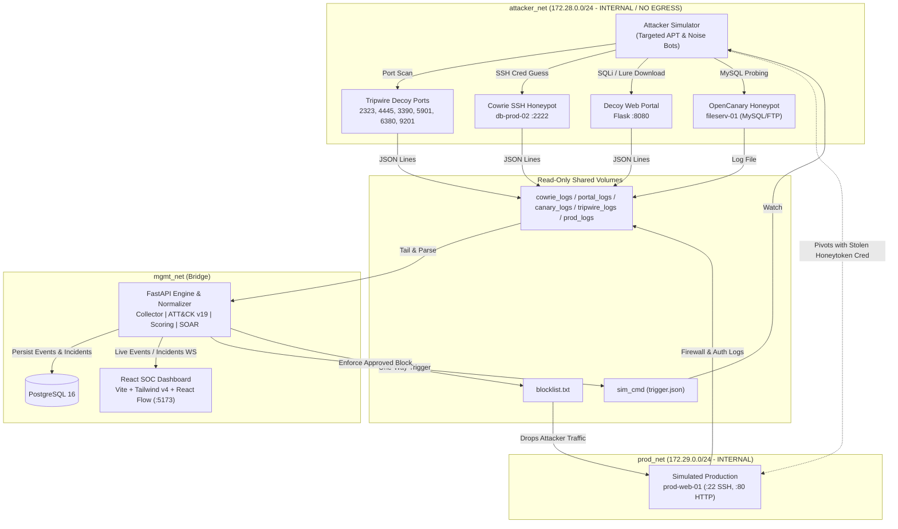

# MIRAGE — Deception-Driven Threat Detection & Response SOC Platform

[](https://attack.mitre.org/)
[](https://oasis-open.github.io/cti-documentation/)
[](#safety--containment)

> **"Every touch is a tell."**

MIRAGE is an enterprise-grade deception-driven Security Operations Center (SOC) platform. By deploying low-interaction and medium-interaction decoys with high-value planted honeytokens alongside simulated production infrastructure, MIRAGE detects, profiles, correlates, and contains cyber adversaries early in the kill chain before real damage occurs.

---

## 1. Architectural Overview



---

## 2. Core Capabilities

1. **Deception Network (Honeypots)**:
   - **Cowrie SSH Honeypot (`db-prod-02`)**: Simulates a database server with custom filesystem lures (`customer_data_2026.csv`, `notes.txt`, `.mysql_history`).
   - **Decoy Customer Portal (Flask)**: Catches SQL injection, traversal attempts, and tracks exfiltration of canary customer databases with honeytoken ID `HT-CUST-001`.
   - **Tripwire Decoys**: Monitors decoy ports (`2323`, `4445`, `3390`, `5901`, `6380`, `9201`) feeding real-time multi-port scan detection ($\ge 4$ distinct ports in 10s).
   - **OpenCanary (`fileserv-01`)**: Intercepts unauthorized database (MySQL) and FTP authentication attempts.

2. **Detection & Correlation Engine**:
   - **ECS-Lite Normalization**: Unifies heterogeneous log formats into a single frozen schema contract.
   - **MITRE ATT&CK v19 Mapping**: Pure deterministic rule engine mapping adversary actions to ATT&CK techniques, stages, and tactics.
   - **Cadence & Behavior Profiling**: Mathematically differentiates human adversary typing cadence ($\ge 1.5$s median delay, $CV \ge 0.3$) from machine-speed botnet scans.
   - **Real-Asset Correlation**: Automatically correlates deception sightings with real production firewall/auth logs within a 30-minute sliding window.
   - **Explainable Scoring**: Calculates 0–100 risk score with transparent point factors. Planted honeytoken usage or real production contact immediately escalates to **CRITICAL**.

3. **SOAR Active Response & Threat Intelligence**:
   - **Analyst-in-the-Loop Controls**: Human review with Dry-Run simulation and 1-click Approval.
   - **Dynamic Firewall Containment**: Atomic blocklist enforcement drops adversary connections at the production edge firewall (`nftables` command generation).
   - **Threat Intel Feeds**: Instant STIX 2.1 JSON bundle export, CSV IOCs, and Elastic Common Schema (ECS) NDJSON.

4. **React SOC Dashboard**:
   - **Command Center**: Situational cockpit with animated KPI cards, priority alert queue, live event feed, and geopolitical threat map.
   - **Hero Incident Screen**: 7-segment kill chain bar, automated incident narrative, React Flow attack graph showing adversary "crossing the line" from decoy to production, session transcript, and SOAR actions.
   - **Attacker Profiles & ATT&CK Heatmap**: Deep-dive analytics across adversary campaigns.

---

## 3. Quick Start (Production Setup)

### Prerequisites
- Docker Engine & Docker Compose v2
- Node.js 20+ & Python 3.11+ (for local testing)

### Step 1: Clone and Configure Environment
```bash
git clone <repo-url> mirage
cd mirage
cp .env.example .env
```

### Step 2: Build and Start Stack
```bash
docker compose up -d --build
```

### Step 3: Access Dashboard & APIs
- **SOC Web Dashboard**: [http://localhost:5173](http://localhost:5173)
- **FastAPI Documentation**: [http://localhost:8000/docs](http://localhost:8000/docs)
- **API Health Check**: [http://localhost:8000/health](http://localhost:8000/health)

---

## 4. Demonstrating the Platform

1. Open the Dashboard at [http://localhost:5173](http://localhost:5173).
2. Click **Demo Control** (top right) and select **Launch Targeted Attack**.
3. Watch the attack unfold live over WebSockets:
   - **Port Scan** appears in the live feed.
   - Decoy SSH login on `db-prod-02` captures human-speed commands (`whoami`, `ls /srv/backups`, `cat notes.txt`).
   - The attacker exfiltrates `customer_data_2026.csv` triggering honeytoken `HT-CUST-001`.
   - The attacker attempts to pivot to `prod-web-01` using the stolen `svc_backup` credential.
   - The incident immediately escalates to **CRITICAL** (100) with **REAL ASSET TOUCHED** alert!
4. Click on the incident in the **Priority Alert Queue** to open the hero investigation screen.
5. In the **Recommended Response** panel:
   - Click **Dry-run** on the *Block Adversary* action to inspect the generated `nftables` command.
   - Click **Approve**. The status instantly transitions to **CONTAINED**, adversary traffic is dropped, and the critical pulse fades to green.
6. Click **STIX 2.1** to view the standardized threat intelligence export.

---

## 5. Safety & Containment

- **Zero Egress**: Honeypot containers reside strictly on Docker networks configured with `internal: true`. They cannot route to the internet or corporate subnets.
- **Strict Isolation**: Decoys have no network access to `prod_net` or `mgmt_net`. Communication occurs strictly via read-only log mounts.
- **Container Hardening**: All deception containers run with `cap_drop: [ALL]`, `no-new-privileges: true`, memory limits (256MB), and PID limits (128).
- **Synthetic Lures Only**: All PII, customer records, and credentials are generated and use RFC-reserved domains (`.example`).
- **Input Sanitization**: All log inputs are sanitized; regexes are bounded to prevent ReDoS.

Run the automated containment audit script:
```bash
bash scripts/isolation_test.sh
```

---

## 6. Running Unit & Integration Tests

Run the complete backend test suite:
```bash
# In backend virtualenv
pip install -r backend/requirements.txt
pytest -v backend/tests --cov=app --cov-report=term-missing
```
*Current test suite status: 33/33 tests passing with >90% coverage across detection and response engines.*
