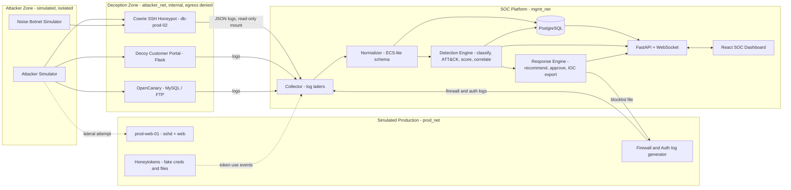
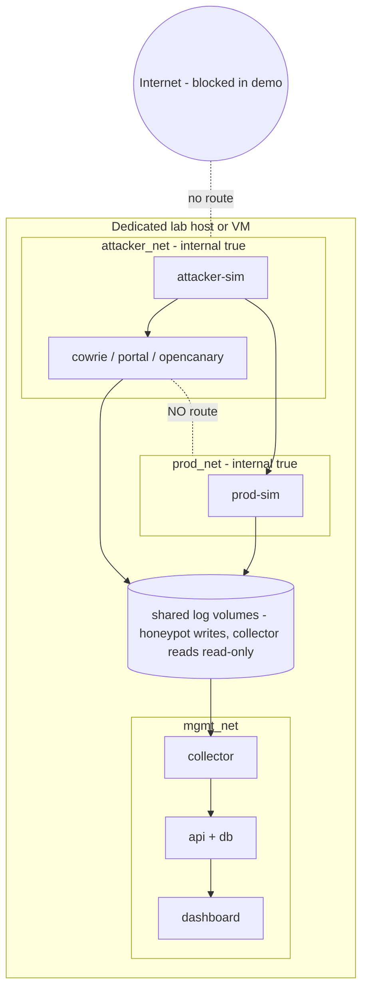
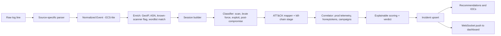
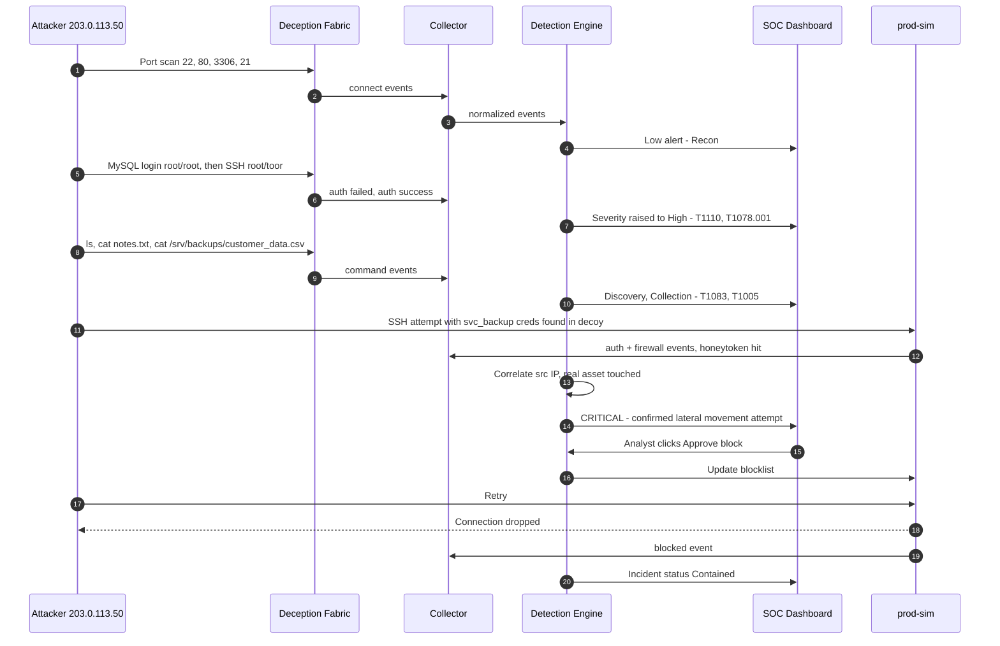
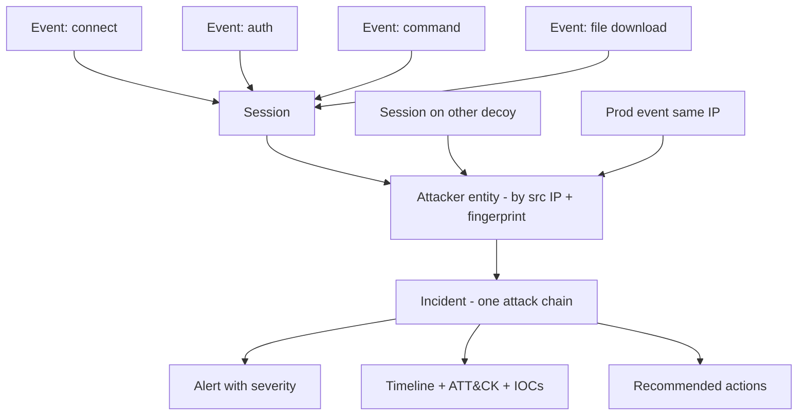
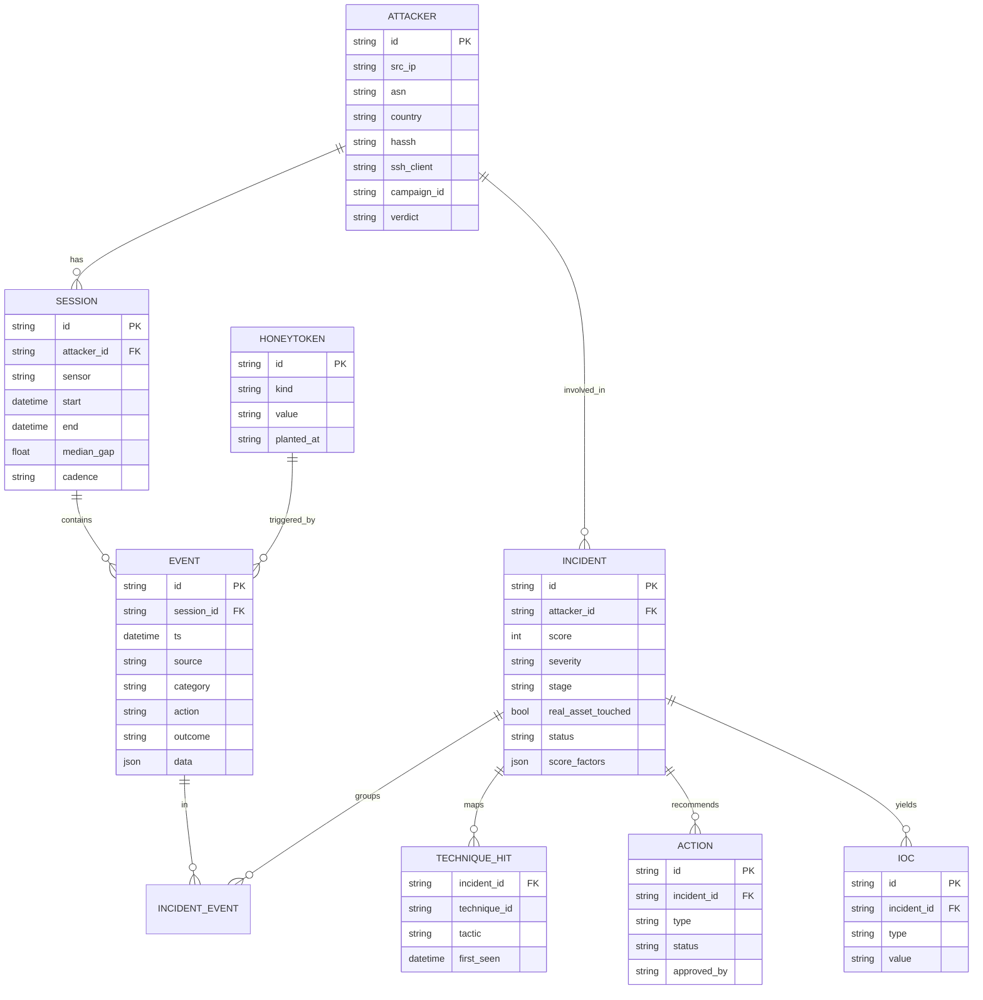
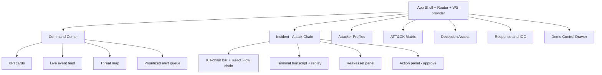

# 03 — Architecture & Diagrams

> All diagrams are Mermaid. Render in GitHub, VS Code (Markdown Preview Mermaid), https://mermaid.live → export PNG/SVG for slides.

## 1. High-level system architecture

## 2. Network isolation topology (the safety story)

Key: **honeypots share no network with prod or mgmt**. Only a one-way log volume leaves the deception zone.

## 3. Event data-flow pipeline

## 4. The demo attack — sequence diagram

## 5. Attack-chain model (how events become an incident)

## 6. Database ER diagram

## 7. Dashboard component map

## 8. Deployment view (compose services)

| Service | Image/Build | Network(s) | Ports (host) |
|---|---|---|---|
| cowrie | `cowrie/cowrie` | attacker_net | internal 2222 |
| portal | build `./honeypots/portal` | attacker_net | internal 8080 |
| opencanary | build `./honeypots/opencanary` | attacker_net | internal 3306, 21 |
| prod-sim | build `./prod-sim` | prod_net | internal |
| collector+api | build `./backend` | mgmt_net (+ read-only log vols) | 8000 |
| db | `postgres:16` | mgmt_net | internal |
| web | build `./frontend` | mgmt_net | 5173 |
| attacker-sim | build `./sim` | attacker_net + prod_net only (**never mgmt_net**) | none. Triggered by a one-way `sim_cmd` volume: API writes a JSON file, sim reads it (read-only mount) |
