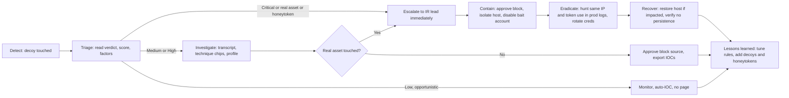

# 11 — Submission Documentation (Design, Isolation, Logic, IR Workflow)

> This is the deliverable "Documentation explaining the deception design, network isolation, detection and prioritization logic, and recommended incident response workflow". Paste into the repo as `README.md` / `docs/`, trimming as needed.

---

## 1. Overview
**MIRAGE** is a deception-driven threat detection and response platform. A fabric of decoy services and honeytokens captures attacker activity; a SIEM-style pipeline normalizes it; a rule-based engine classifies, maps to MITRE ATT&CK, correlates with production telemetry, scores, and recommends response; a SOC dashboard presents each attack as one actionable incident.

## 2. Deception design

### 2.1 Decoy inventory
| Decoy | Looks like | Tech | Captures | Lures |
|---|---|---|---|---|
| `db-prod-02` | Production database server over SSH | Cowrie (medium-interaction) | Logins, every command, file transfers, SSH client/HASSH | `/srv/backups/customer_data_2026.csv`, `~dbadmin/notes.txt` (bait creds), `.mysql_history` |
| Customer Data Portal | Internal web app | Custom Flask | Logins, SQLi/traversal attempts, **file downloads** with hashes | `/download/customer_data_2026.csv`, `robots.txt` → `/admin-backup/` |
| `fileserv-01` | MySQL + FTP server | OpenCanary | Login attempts with credentials | Default-credential acceptance behavior |
| `tripwire-01` | Misc. exposed services (telnet, SMB, RDP, VNC, Redis, Elasticsearch ports) | Python sockets | Connection attempts (feeds scan detection) | — |

### 2.2 Design principles
1. **No legitimate use** → every interaction is suspicious.
2. **Believable**: realistic hostnames, banners, file names, data shapes.
3. **Instrumented**: structured logs from every decoy; file hashes recorded.
4. **Honeytokens**: fake credentials/data that alert wherever they are used (including real systems).
5. **Disposable & safe**: rebuild anytime; no real data or credentials.

### 2.3 Honeytoken registry
| ID | Type | Location | Trigger |
|---|---|---|---|
| HT-CRED-001 | Credential `svc_backup` | `notes.txt` on decoy | Any auth attempt with that user anywhere |
| HT-CUST-001 | Canary record (`ht001.canary@acme-corp.example`) | Customer CSV | File access/download |
| HT-PATH-001 | Lure path `/admin-backup/` | `robots.txt` | Request |

## 3. Network isolation (summary; full detail in file 09)
- Three Docker networks: `attacker_net` (internal), `prod_net` (internal), `mgmt_net`.
- Decoys live **only** on `attacker_net` ⇒ no route to prod or SOC, no internet.
- Logs flow one way via volumes mounted **read-only** into the collector.
- Containers: `cap_drop ALL`, `no-new-privileges`, memory/PID limits, read-only filesystems where possible.
- Simulator never joins `mgmt_net`; triggered by a one-way file volume.
- Evidence: `scripts/isolation_test.sh` output and `docker network inspect` snapshots.

## 4. Data pipeline
```
Decoy/prod logs → Tailer → Parser → NormalizedEvent (ECS-lite) → DB → Classifier/ATT&CK mapper → Evaluator → Incident → WebSocket → Dashboard
```
- **Schema:** `@timestamp, source, sensor, zone, session_id, src_ip, dst_service, action, outcome, user, cmd, file{name,sha256,size,url}, honeytoken_id, ssh{client,hassh}, flags, techniques, stage`.
- **SIEM readiness:** `GET /api/export/ecs.ndjson` emits Elastic Common Schema-style records; STIX 2.1 for intel sharing.

## 5. Detection & prioritization logic (summary; full detail in file 07)
- **Classes:** scanning, brute force, initial access, exploitation, post-compromise, exfiltration, persistence, lateral movement, impact.
- **ATT&CK mapping:** YAML rule file; each event produces technique IDs and a kill-chain stage.
- **Scoring:** stage base points + explainable modifiers (cadence, multi-decoy, crown-jewel access, real-asset touch, honeytoken, return visits; minus wordlist-only, machine speed, drive-by).
- **Severity:** Low <30, Medium 30–59, High 60–84, Critical ≥85. Honeytoken use or real-asset contact forces Critical.
- **Verdict:** Targeted vs. Opportunistic from weighted evidence tallies.
- **Correlation:** same source IP across decoys and production firewall/auth telemetry within 30 min.
- **Profile:** source, ASN/country, SSH client/HASSH, cadence class, credentials tried, targets touched, timeline.

## 6. Recommended incident response workflow

### 6.1 Roles
| Role | Responsibility |
|---|---|
| Tier-1 analyst | Triage queue top-down, validate verdict, approve routine containment |
| Tier-2 / IR lead | Investigate Critical/targeted incidents, hunt, coordinate remediation |
| Threat intel | Consume IOCs, enrich, share |
| SOC manager | Review KPIs, tune rules, decide on deception expansion |

### 6.2 Workflow (NIST SP 800-61-aligned)



### 6.3 Playbook table
| Severity / condition | SLA target | Steps |
|---|---|---|
| **Low / opportunistic** | none (batch review daily) | Auto-collect IOCs; consider adding to edge blocklist in bulk |
| **Medium** | 4 h | Review transcript; confirm no prod contact; block if behavior escalates |
| **High** | 1 h | Validate; block source (approve); export IOCs; watch for prod contact |
| **Critical (real asset / honeytoken)** | 15 min | Approve block + isolate; run generated hunt queries; rotate bait-related credentials and audit where the credential type exists; preserve evidence (transcript, file hashes); open ticket; notify IR lead |
> SLAs are illustrative recommendations, adjust to org policy.

### 6.4 Analyst checklist for the demo incident
1. Read the header: severity, score, verdict.
2. Check kill-chain position (how far).
3. Read the narrative and ATT&CK chips (what).
4. Inspect real-asset panel (reach).
5. Review transcript for intent.
6. Dry-run → Approve block (contain).
7. Run hunt query; rotate `svc_backup`; export STIX.
8. Close with note; feed lessons back (rule tune / new decoys).

## 7. Automated response & threat intelligence
| Output | Format | Use |
|---|---|---|
| Blocklist | text/nft set | Edge firewall |
| IOC bundle | STIX 2.1 JSON | TIP/MISP/peer sharing |
| IOC list | CSV | Quick import to controls |
| Hunt queries | Splunk SPL + KQL | Search prod telemetry |
| SIEM events | ECS NDJSON | Forward into existing SIEM |
| Webhook | JSON → Slack/Discord | Real-time paging |

Guardrails: human approval for production-affecting actions, dry-run previews, allowlist, audit trail.

## 8. Testing & validation
Acceptance tests AT-01…AT-16 (file 10), unit tests for classification and scoring, isolation test script, repeatable simulated scenarios (Noise Storm, Targeted Intruder).

## 9. Limitations & future work
- Rule-based scoring; no ML. Future: learning-to-rank from analyst feedback.
- IP-based identity; add campaign clustering by fingerprints and graph analytics.
- Simulated production; future: ingest real Windows/Linux auth and EDR telemetry.
- Add decoys: Windows/RDP, Kubernetes API, cloud storage canaries, Active Directory honey accounts, adaptive decoys.
- Direct SOAR integration (Shuffle/Cortex), TAXII feeds.

## 10. Ethics, legality, safety
See file 09 §8. All traffic is simulated; data and credentials are synthetic; deployment beyond the lab requires the controls in file 09 §5.

## 11. How to run
```bash
git clone <repo> && cd mirage
cp .env.example .env
docker compose up -d --build
# Dashboard: http://localhost:5173  | API docs: http://localhost:8000/docs
# Demo Control → Launch Noise Storm → Launch Targeted Attack → open incident → Approve block
bash scripts/isolation_test.sh
```

## 12. Repo README skeleton
```
# MIRAGE — Every touch is a tell
Badges: docker, python, react, MITRE ATT&CK
1. What it is (3 lines + GIF)
2. Architecture (diagram)
3. Features
4. Quick start
5. Demo walkthrough
6. Safety & isolation
7. Detection logic
8. Project structure
9. Limitations / roadmap
10. Team
```
