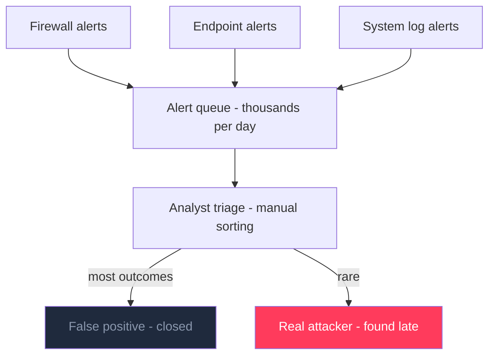
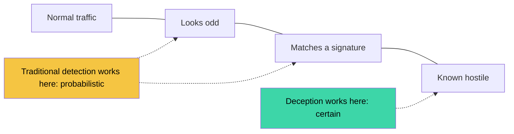
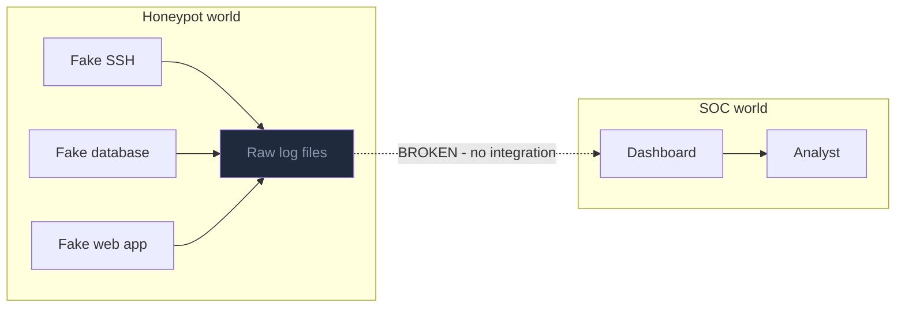
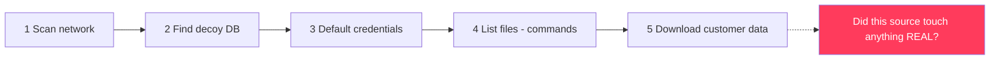
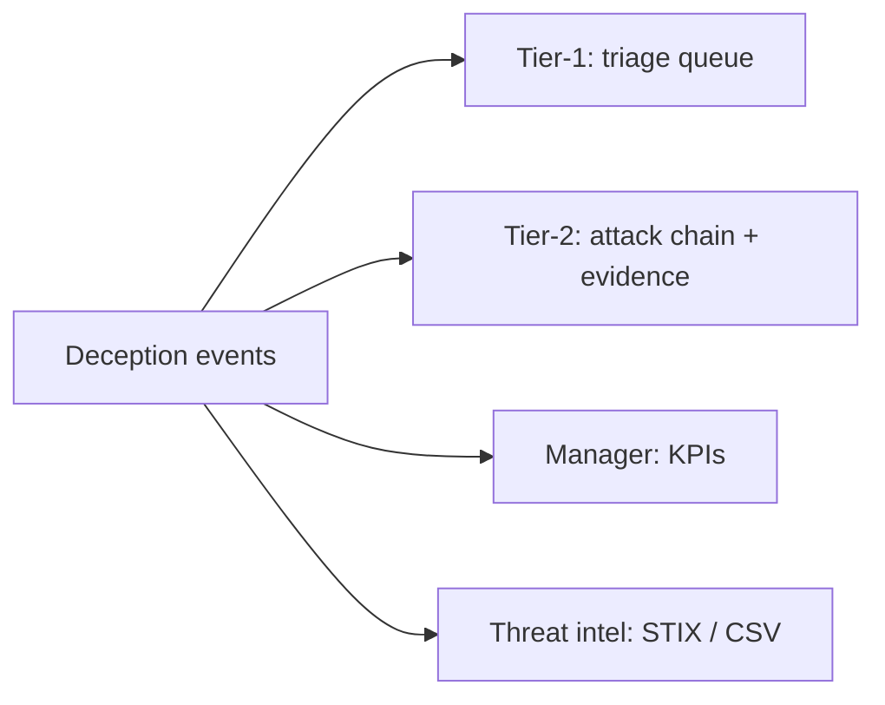
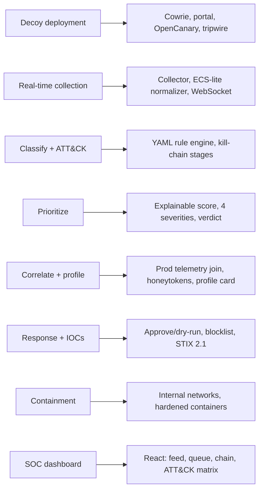

# SECTION 1 — Problem Understanding (Slides 1.1 – 1.6)

> Each slide = **Title · On-slide content · Diagram (Mermaid) · Speaker note**. Render Mermaid at https://mermaid.live → export PNG/SVG for PowerPoint.

---

## Slide 1.1 — The Alert Flood
**Title:** *Thousands of alerts. Almost all noise.*

**On-slide content**
- Firewalls, EDR, and logs generate thousands of alerts daily
- Most alerts turn out to be false positives
- Analysts spend their time sorting noise, not hunting attackers
- Real attackers can stay inside for days before detection

**Diagram — the funnel analysts live in**

**Speaker note:** "Our analyst's problem isn't a lack of data — it's a lack of certainty." *(Use illustrative framing; don't quote unsourced statistics.)*

---

## Slide 1.2 — Why Traditional Detection Falls Short
**Title:** *Signatures guess. They never know.*

**On-slide content**
- Signature and pattern detection hide inside normal traffic
- It can rarely say with confidence: "this is hostile"
- Result: alert fatigue + long attacker dwell time

**Diagram — confidence spectrum**

**Speaker note:** "Detection normally lives in the grey zone. Deception moves the signal to certainty."

---

## Slide 1.3 — The Deception Opportunity (and the Gap)
**Title:** *Honeypots give certainty. The SOC never sees it.*

**On-slide content**
- A honeypot is a decoy (fake SSH, web app, database) with **no business use**
- **Any interaction is suspicious by definition** → high-fidelity indicator of compromise
- But honeypot data stays in raw log files and never reaches the SOC in actionable form
- Without integration, the SOC sees no connected attack

**Diagram — the broken link**

**Speaker note:** "The signal exists. It just never reaches a human in a usable form."

---

## Slide 1.4 — The Attack the PS Describes
**Title:** *One attacker. Six steps. Zero visibility.*

**On-slide content**
1. Scans the network
2. Finds a decoy database exposed
3. Tries default credentials
4. Runs commands to list files
5. Downloads a fake "customer data" file
6. SOC sees none of it as a **connected** attack

**Diagram — the attack chain we must reconstruct**

**Speaker note:** "Our system must answer one question analysts care about: who, how far, did they touch anything real?"

---

## Slide 1.5 — Who Is Affected & What They Need
**Title:** *Four people, one shared pain*

| Persona | Pain | Need |
|---|---|---|
| Tier-1 analyst | Alert fatigue, no context | Few high-confidence incidents + verdict |
| Tier-2 / IR lead | Manual timeline rebuilding | Attack chain, evidence, containment |
| SOC manager / CISO | Can't prove deception adds value | KPIs: noise cut, time-to-detect |
| Threat-intel analyst | No shareable indicators | One-click IOC / STIX export |

**Diagram — who consumes what**

**Speaker note:** "We designed one data source, four views."

---

## Slide 1.6 — What the Challenge Asks (Requirements → Our Answer)
**Title:** *Every requirement mapped*

**On-slide content:** Deploy decoys · Real-time collection · Classify + ATT&CK map · Prioritize (low→critical) · Correlate + profile · Automated response + IOCs · Containment & safety · Dashboard

**Diagram — requirement coverage map**

**Speaker note:** "This is our checklist — and each row becomes a live feature in the demo."
