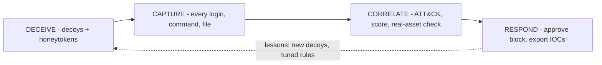
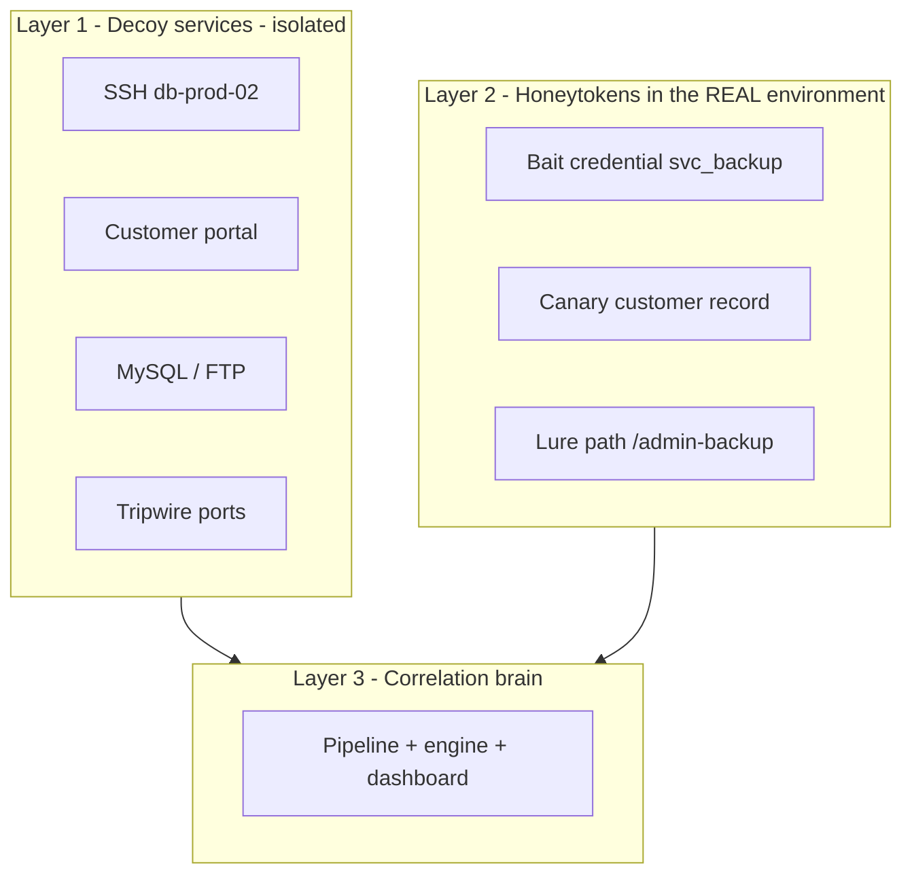
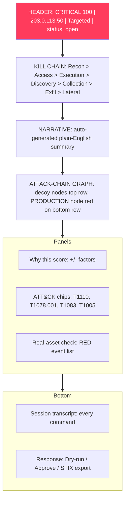
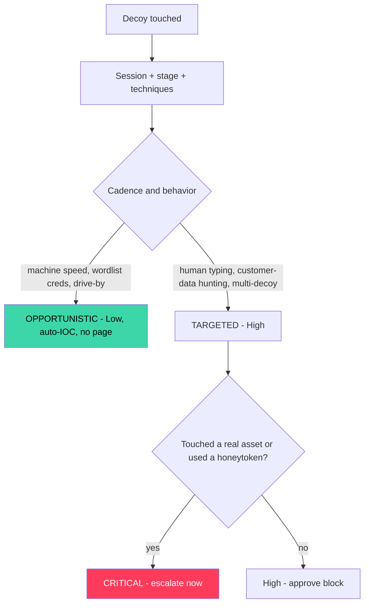
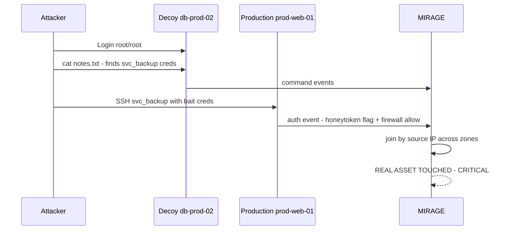
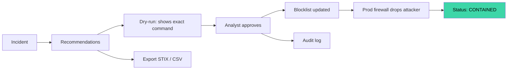
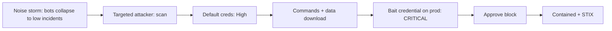

# SECTION 2 — Proposed Solution: MIRAGE (Slides 2.1 – 2.7)

---

## Slide 2.1 — Our Idea in One Line
**Title:** *MIRAGE — Every touch is a tell.*

**On-slide content**
- Turn every decoy touch into **one attack story**
- Who · what · how far · did they touch anything real · what to click
- One incident → one screen → one approved click to contain

**Diagram — four-step loop**

**Speaker note:** "Four verbs. That's the whole product."

---

## Slide 2.2 — The Deception Fabric
**Title:** *Believable decoys, instrumented everywhere*

**On-slide content**
| Decoy | Looks like | Captures |
|---|---|---|
| db-prod-02 (Cowrie) | Production DB server over SSH | Logins, every command, file transfers |
| Customer Portal (Flask) | Internal web app | Logins, SQLi/traversal, **downloads + hashes** |
| fileserv-01 (OpenCanary) | MySQL + FTP | Credential attempts |
| Tripwire ports | Telnet, SMB, RDP, VNC, Redis | Scan / connection attempts |
| **Honeytokens** | Bait credentials, canary data | Use anywhere = confirmed attacker |

**Diagram — fabric layers**

**Speaker note:** "Decoys catch attackers who explore. Honeytokens catch the ones who already got into real systems."

---

## Slide 2.3 — One Incident, One Screen (the hero slide)
**Title:** *The analyst sees the whole attack chain at once*

**On-slide content:** source & profile · every command · ATT&CK techniques · kill-chain progress · real-asset check · severity · recommended action

**Diagram — wireframe of the incident screen**

**Speaker note:** "This single screen answers every question in the problem statement's example."

---

## Slide 2.4 — Signal vs Noise: the Verdict
**Title:** *Opportunistic noise vs. targeted attacker*

**On-slide content**
- Confidence is free (it's a decoy) — **priority is earned**
- Priority = **Progress** (how far) + **Intent** (targeted?) + **Reach** (real assets?)
- Severity: Low · Medium · High · Critical, each with a visible "why"

**Diagram — decision flow**

**Speaker note:** "Alert fatigue drops because analysts ask 'how urgent?', not 'is it real?'."

---

## Slide 2.5 — The Differentiator: Real-Asset Correlation
**Title:** *"Did they touch anything real?" — answered automatically*

**On-slide content**
- Same source IP searched across production firewall + auth logs
- Bait credential from a decoy used on a real host = **confirmed lateral movement**
- Auto-escalates to **Critical**

**Diagram — correlation path**

**Speaker note:** "Honeypots alone can't tell you this. Honeytokens in real systems can."

---

## Slide 2.6 — Response That Closes the Loop
**Title:** *Recommend → Dry-run → Approve → Attacker dropped*

**On-slide content**
- Block source · isolate host · rotate bait credentials · hunt queries (SPL/KQL)
- Export IOCs: **STIX 2.1**, CSV, blocklist, ECS NDJSON
- Human approval for anything touching production; allowlist + audit trail

**Diagram — response workflow**

**Speaker note:** "The judges see cause and effect: click, and the attacker's next connection is dropped."

---

## Slide 2.7 — The Demo Story
**Title:** *Watch one attack, start to finish*

**Diagram — demo timeline**

**Speaker note:** "About 3 minutes live. Everything runs offline in an isolated lab."
