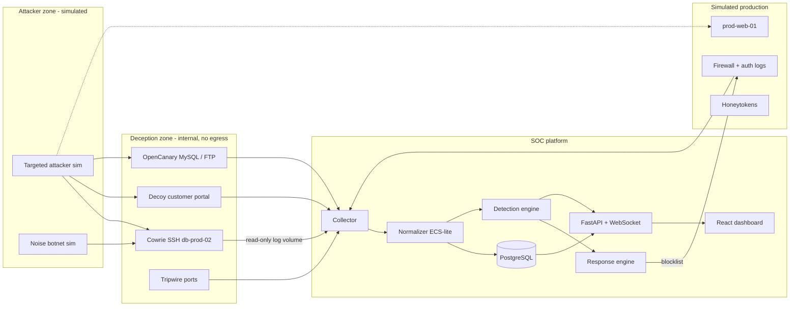
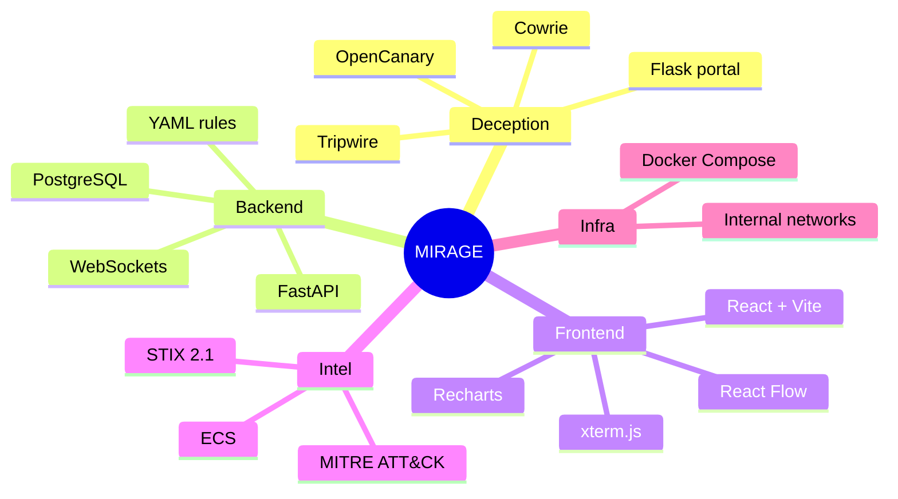
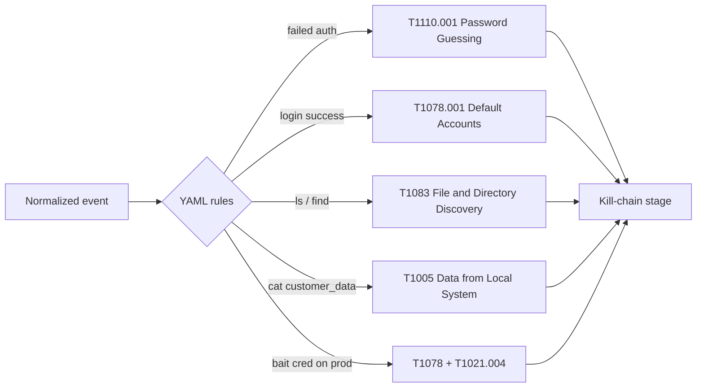
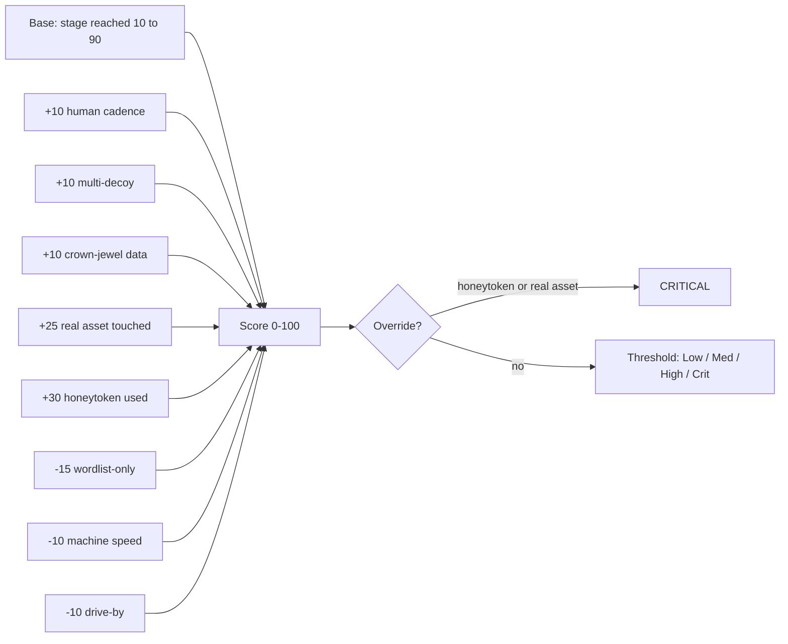
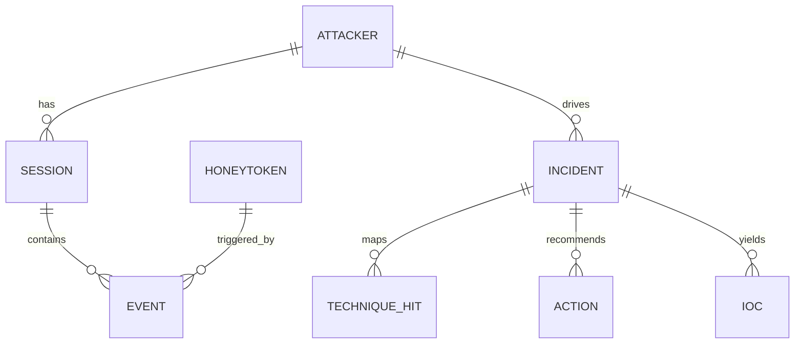
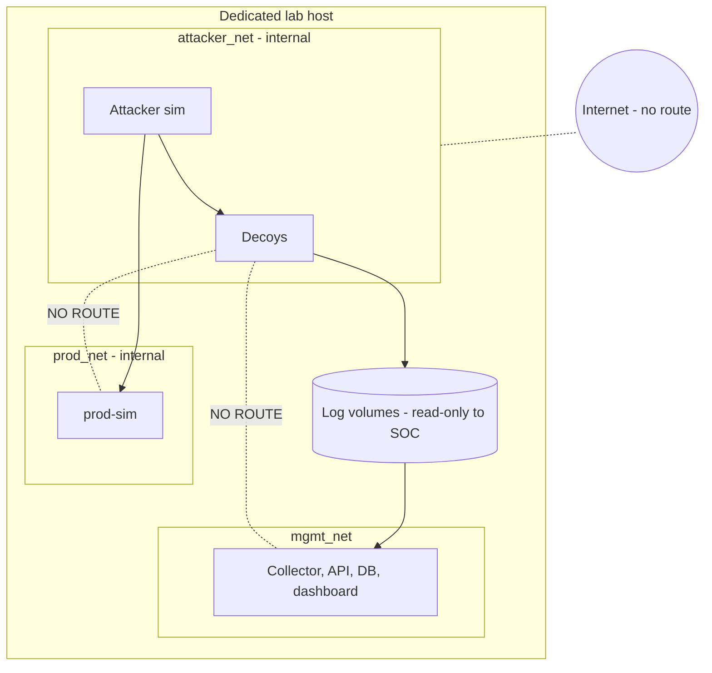
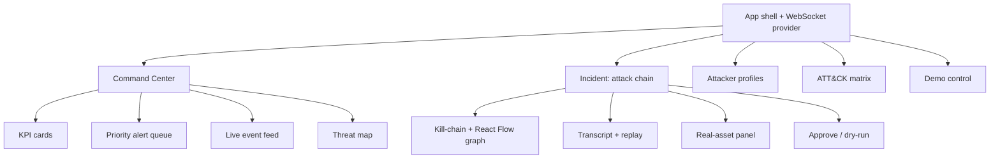
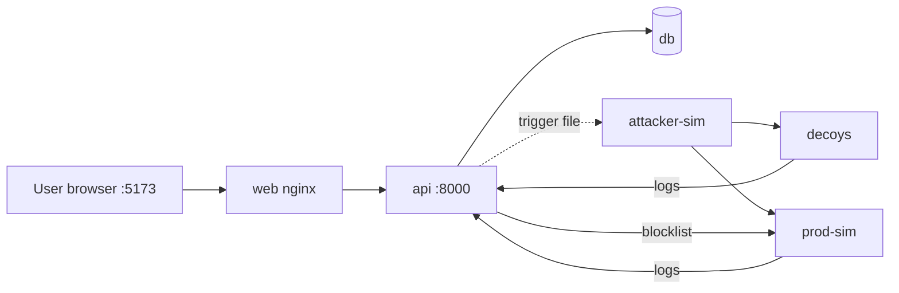
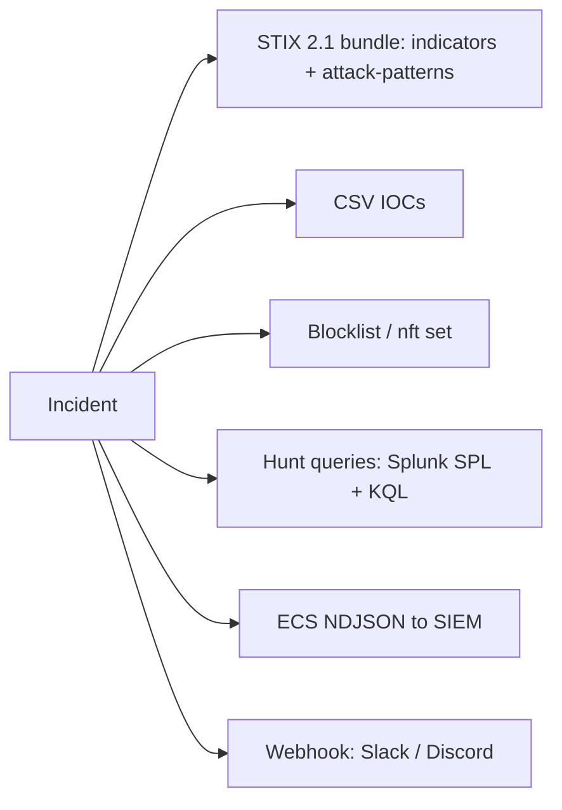

# SECTION 3 — Technical Approach (Slides 3.1 – 3.10)

---

## Slide 3.1 — System Architecture
**Title:** *SIEM-style pipeline, deception-native logic*

**On-slide content:** Four zones — Attacker · Deception · Production · SOC. Decoys share **no network** with production.

**Diagram**

**Speaker note:** "Logs flow one way. The only thing going back to production is an approved blocklist entry."

---

## Slide 3.2 — Data Pipeline
**Title:** *From raw log line to analyst decision in under a second*

**On-slide content:** Collect → Normalize → Enrich → Detect scan → Classify + ATT&CK → Correlate → Score → Incident → Push

**Diagram**

```mermaid
flowchart LR
  A["Raw log line"] --> B["Parser per source"]
  B --> C["NormalizedEvent ECS-lite"]
  C --> D["Enrich: geo, ASN, flags"]
  D --> E["Scan detector: 4 ports in 10 s"]
  E --> F["Classifier + ATT&CK mapper"]
  F --> G["Correlator: decoys + prod, same IP"]
  G --> H["Scoring + verdict"]
  H --> I["Incident upsert"]
  I --> J["WebSocket push"]
```

**Speaker note:** "One schema for every source — that's what makes it SIEM-compatible."

---

## Slide 3.3 — Technology Stack
**Title:** *Proven components, one-command deploy*

| Layer | Choice |
|---|---|
| SSH honeypot | **Cowrie** |
| Multi-service decoys | **OpenCanary**, custom Python tripwire |
| Web decoy | **Flask** (custom portal) |
| Backend | **FastAPI**, SQLAlchemy, WebSockets |
| Database | **PostgreSQL 16** (JSONB) |
| Rules | **YAML** ATT&CK map + pure-Python engine |
| Frontend | **React + Vite + TypeScript + Tailwind**, React Flow, Recharts, xterm.js |
| Intel formats | **STIX 2.1**, CSV, ECS NDJSON |
| Orchestration | **Docker Compose** |

**Diagram**

**Speaker note:** "We chose mature components so 24 hours go into integration and analytics, not reinventing honeypots."

---

## Slide 3.4 — Detection & Classification Engine
**Title:** *Explainable rules mapped to MITRE ATT&CK*

**On-slide content**
- Classes: scanning · brute force · initial access · exploitation · post-compromise · exfiltration · persistence · lateral movement
- YAML rules: action/outcome/command-regex/flags → technique IDs + kill-chain stage
- Tactic labels are config (ATT&CK v19 split Defense Evasion into Stealth / Impair Defenses)

**Diagram**

**Speaker note:** "Every event gets technique IDs and a stage — no black box."

---

## Slide 3.5 — Scoring & Prioritization
**Title:** *Every severity comes with a visible "why"*

| Severity | Score |
|---|---|
| Critical | ≥ 85 (or honeytoken / real-asset override) |
| High | 60–84 |
| Medium | 30–59 |
| Low | < 30 |

**Diagram — score composition**

**Speaker note:** "Analysts trust what they can audit."

---

## Slide 3.6 — Correlation & Attacker Profiling
**Title:** *Linking decoys, production, and honeytokens*

**On-slide content:** Entity = source IP (+ HASSH/client fingerprint for campaigns). Profile: geo/ASN, tooling, cadence (human/scripted/bot), creds tried, targets touched, timeline.

**Diagram — ER view**

**Speaker note:** "Attacker is the entity; incident is the story."

---

## Slide 3.7 — Network Isolation & Containment
**Title:** *The honeypot can never be a pivot*

**On-slide content:** internal networks, no egress, hardened containers, one-way logs, human approval, allowlist.

**Diagram**

**Speaker note:** "We ship an isolation test script — all PASS lines go on this slide as evidence."

---

## Slide 3.8 — Live Dashboard Architecture
**Title:** *Real-time, analyst-first UI*

**Diagram — component map**

**Speaker note:** "Build order: incident page first — it carries the whole story."

---

## Slide 3.9 — Deployment View
**Title:** *`docker compose up` — fully offline*

| Service | Network | Notes |
|---|---|---|
| cowrie, portal, tripwire, opencanary | attacker_net | hardened, no egress |
| prod-sim | prod_net | firewall/auth logs + blocklist enforcement |
| api + collector, db, web | mgmt_net | read-only log mounts |
| attacker-sim, noise-sim | attacker_net (+ prod_net for targeted) | triggered via one-way volume |

**Diagram**

**Speaker note:** "Nothing needs the internet — safe for any venue Wi-Fi."

---

## Slide 3.10 — Threat Intel & Export
**Title:** *Close the intelligence loop*

**Diagram**

**Speaker note:** "Everything we capture can leave the system in a standard format."
