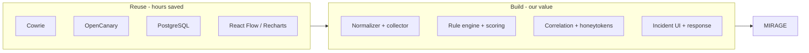
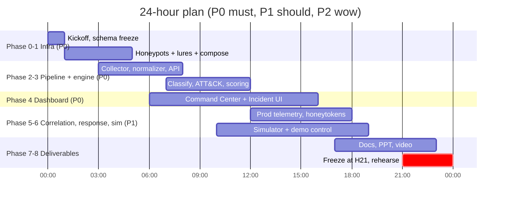
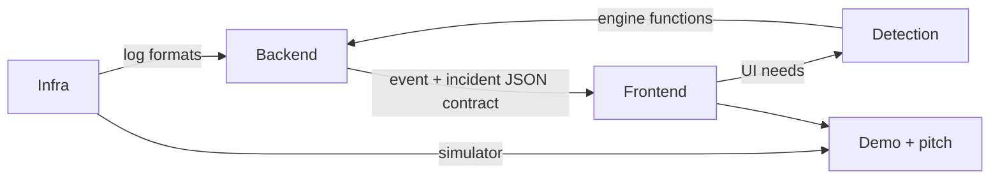
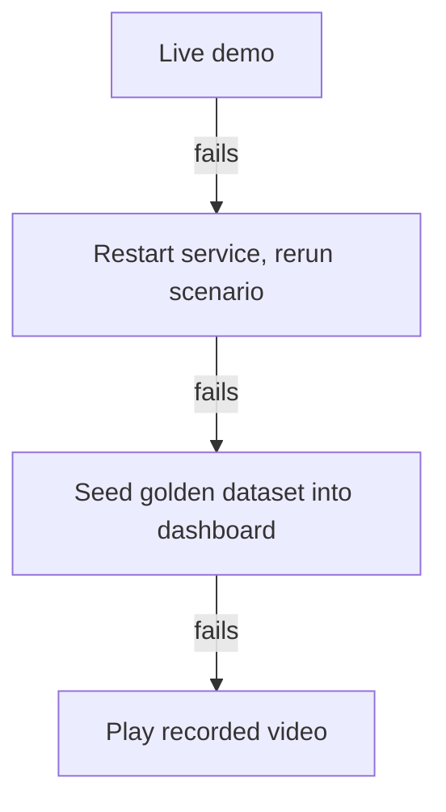
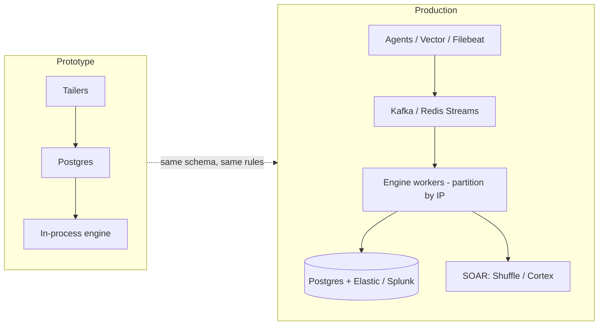
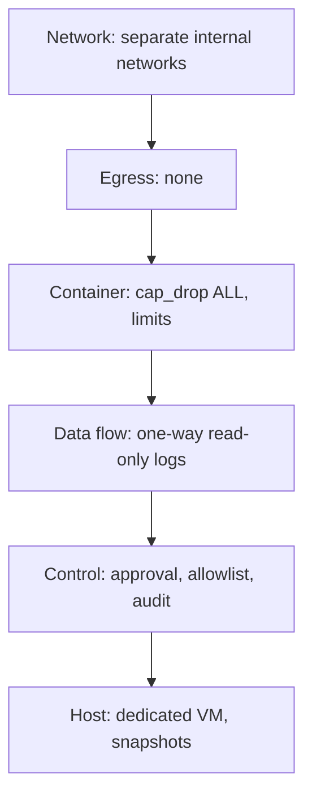
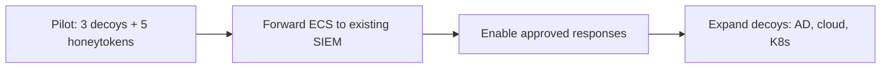

# SECTION 4 — Feasibility & Viability (Slides 4.1 – 4.7)

---

## Slide 4.1 — Why It's Feasible in 24 Hours
**Title:** *Mature parts, thin glue*

**On-slide content**
- Honeypots: **reuse** Cowrie + OpenCanary, **custom only** where we need control (portal, tripwire, prod-sim)
- Logic: pure Python rules + YAML — **no ML training, no data collection**
- UI: React + off-the-shelf libraries (React Flow, Recharts)
- Run: one `docker compose up`, **fully offline**

**Diagram — build vs. reuse**

**Speaker note:** "We spent our hours on the part nobody else gives you: the analyst's decision."

---

## Slide 4.2 — 24-Hour Execution Plan
**Title:** *Phased, priority-first, with a code freeze*

**Diagram — Gantt**

**Speaker note:** "Code freeze at hour 21; the last three hours are for rehearsal, not features."

---

## Slide 4.3 — Team & Roles
**Title:** *Four roles, parallel work*

| Role | Owns |
|---|---|
| Deception / Infra | Compose, honeypots, prod-sim, isolation, simulator |
| Backend / Pipeline | Collector, normalizer, DB, API, WebSocket |
| Security / Detection | Rules, ATT&CK map, scoring, correlation, IOC/STIX, docs |
| Frontend / Story | Dashboard, polish, PPT, video, pitch |

**Diagram**

**Speaker note:** "The event schema was frozen in hour 0, so teams never block each other."

---

## Slide 4.4 — Technical Risks & Mitigations
**Title:** *We planned for failure*

| Risk | Mitigation |
|---|---|
| Cowrie fake-FS config slow | Time-box 75 min; custom asyncssh fallback (same log shape) |
| OpenCanary setup issues | Optional; demo works without it |
| WebSocket drops | Auto-reconnect + polling fallback |
| Wrong severity on stage | Unit tests + golden dataset seeding |
| Demo timing drift | Tuned delays, 3 rehearsals, backup video |

**Diagram — fallback ladder**

**Speaker note:** "There is always a next fallback — the audience never waits."

---

## Slide 4.5 — Scalability Path (Prototype → Production)
**Title:** *The same design scales out*

**On-slide content**
- Today: tailers + Postgres + in-process engine (demo scale)
- Next: message queue (Redis Streams/Kafka), partition by source IP, incremental evaluator
- Long-term storage and search: forward ECS NDJSON to Elastic/Splunk

**Diagram**

**Speaker note:** "We didn't build a throwaway — the schema and rules carry over unchanged."

---

## Slide 4.6 — Safety, Legal & Ethical Viability
**Title:** *Safe by design, honest by default*

**On-slide content**
- All attack traffic simulated in our isolated lab
- All data synthetic (reserved `.example` domains); bait credentials fictitious
- Real deployments require VLAN/VPC egress denial, provider-terms check, local-law check
- Simulated IPs are Docker addresses mapped to RFC 5737 documentation ranges, and we say so

**Diagram — controls stack**

**Speaker note:** "Safety is not a slide — it's a test script you can run."

---

## Slide 4.7 — Cost & Adoption Viability
**Title:** *Cheap to run, easy to adopt*

**On-slide content**
- Open-source stack — no license cost; runs on a laptop or one small VM
- Plugs in beside an existing SIEM (ECS export) — no rip-and-replace
- Natural buyers: SOC teams, MSSPs, regulated sectors (finance, healthcare)

**Diagram — adoption path**

**Speaker note:** "Value on day one, with a path to full coverage."
