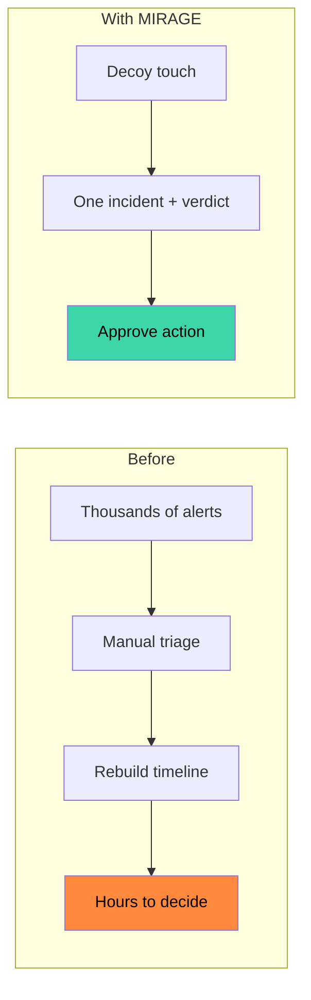
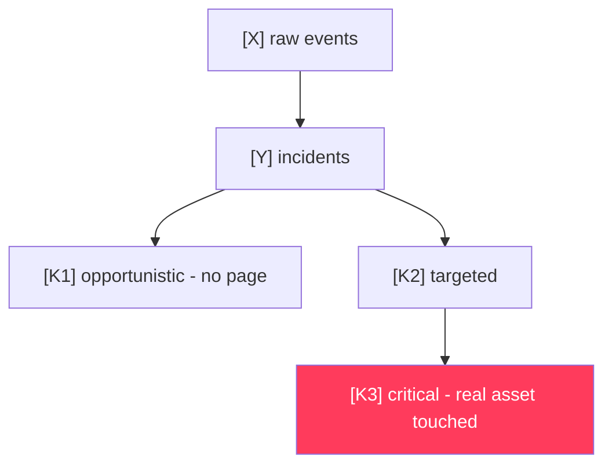
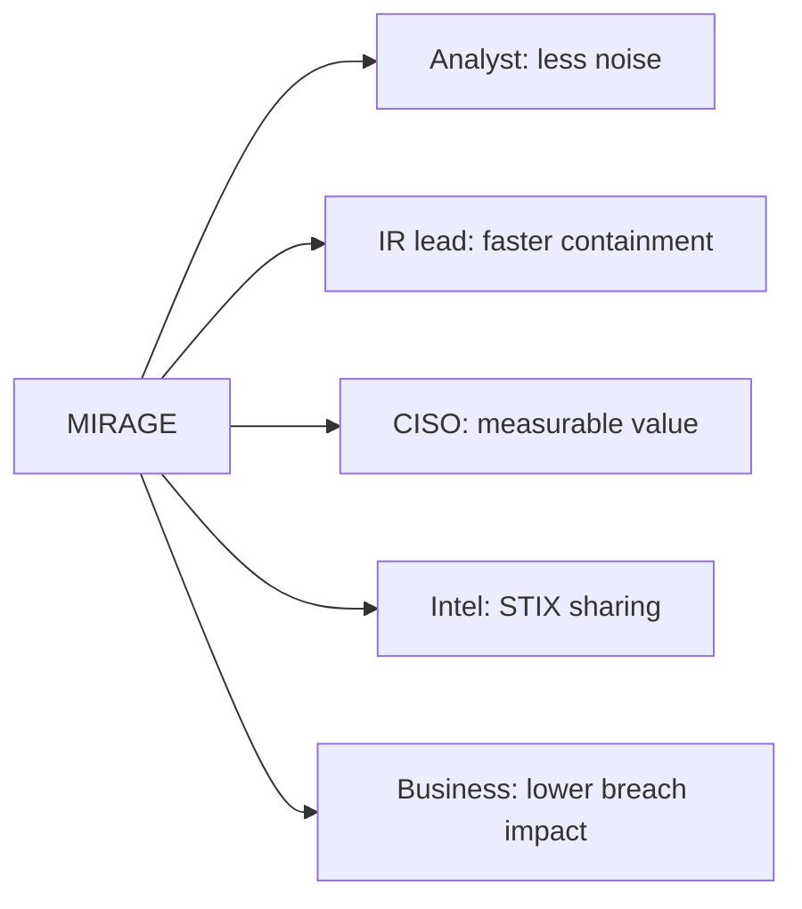
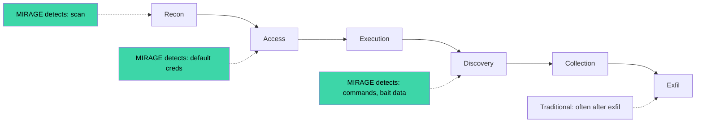
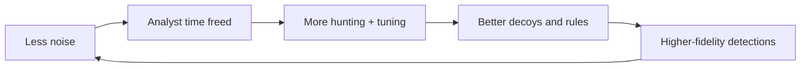
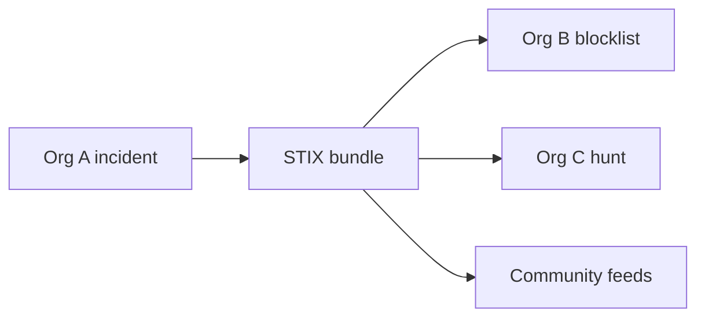

# SECTION 5 — Impacts & Benefits (Slides 5.1 – 5.6)

> **Rule for this section:** every number shown on a slide must come from **your own demo run** (placeholders like `[X]` below). Do not quote unsourced industry statistics.

---

## Slide 5.1 — Before vs. After (Analyst Workflow)
**Title:** *From sorting noise to making decisions*

**On-slide content**
| Before | With MIRAGE |
|---|---|
| Thousands of raw alerts | Few prioritized incidents |
| "Is it real?" | Already certain (decoy) → "How urgent?" |
| Manual timeline rebuild | One attack chain, auto-built |
| Guess if production is affected | Real-asset check automatic |
| Write IOCs by hand | One-click STIX / CSV |

**Diagram**

**Speaker note:** "We don't add another alert source — we replace sorting with one decision."

---

## Slide 5.2 — Measured Impact (Fill From Your Demo Run)
**Title:** *Numbers from our own run*

| KPI | Value | Source |
|---|---|---|
| Raw events ingested | **[X]** | `/api/stats` |
| Incidents raised | **[Y]** | `/api/stats` |
| Noise suppressed | **[(1 − Y/X) × 100]%** | computed live |
| First touch → Critical | **[Z] seconds** | timeline timestamps |
| ATT&CK techniques observed | **[N]** | ATT&CK page |
| Approve → Contained | **[T] seconds** | action log |

**Diagram — KPI funnel**

**Speaker note:** "These numbers are live — we'll show them on the dashboard, not just the slide."

---

## Slide 5.3 — Benefits by Stakeholder
**Title:** *Who wins*

| Stakeholder | Benefit |
|---|---|
| Tier-1 analyst | Less fatigue; confident triage |
| Tier-2 / IR | Faster investigation; evidence ready |
| SOC manager / CISO | Provable ROI of deception; ATT&CK coverage view |
| Threat intel | Shareable, standards-based IOCs |
| Business | Earlier breach detection → less data loss exposure |

**Diagram**

**Speaker note:** "Each role gets a different view of the same truth."

---

## Slide 5.4 — Security Impact: Shrinking Attacker Dwell Time
**Title:** *Catch them where they explore*

**On-slide content**
- Attackers must explore to find data — decoys sit exactly in that path
- Bait credentials turn a quiet foothold into a loud alarm
- Detection happens **at the first interaction**, not after damage

**Diagram — detection earlier in the kill chain**

**Speaker note:** "Decoys convert exploration — which every attacker must do — into detection."

---

## Slide 5.5 — Operational & Business Impact
**Title:** *Less noise, lower cost, faster response*

**On-slide content**
- Fewer pages → analyst time redirected to hunting
- Automated, approved containment → shorter time-to-contain
- Open-source stack → low total cost of ownership
- Intel export → contributes back to the community

**Diagram — value loop**

**Speaker note:** "Value compounds: every incident improves the next detection."

---

## Slide 5.6 — Societal & Industry Impact
**Title:** *Shared defence*

**On-slide content**
- STIX 2.1 sharing helps other organizations block the same attackers
- Low-cost deception is accessible to small teams, schools, and local governments
- Open design encourages community-built decoys and rules

**Diagram**

**Speaker note:** "One organization's catch becomes everyone's defence."
