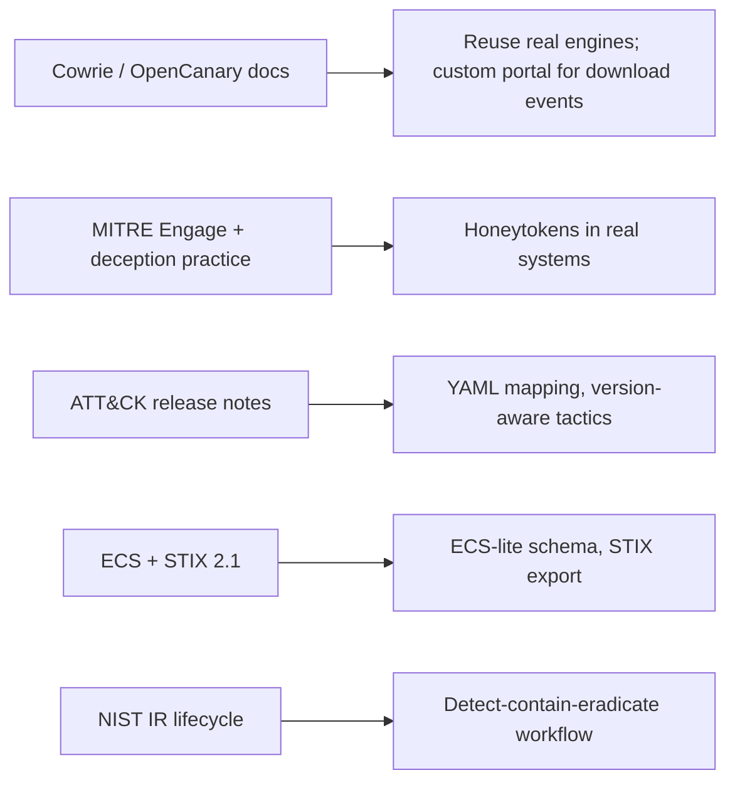
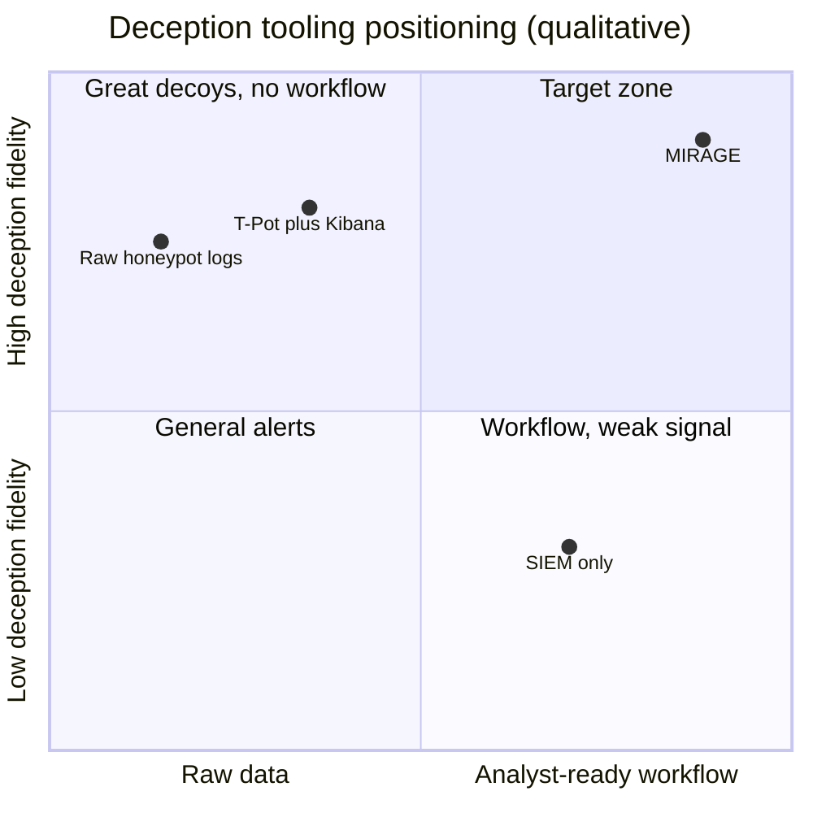
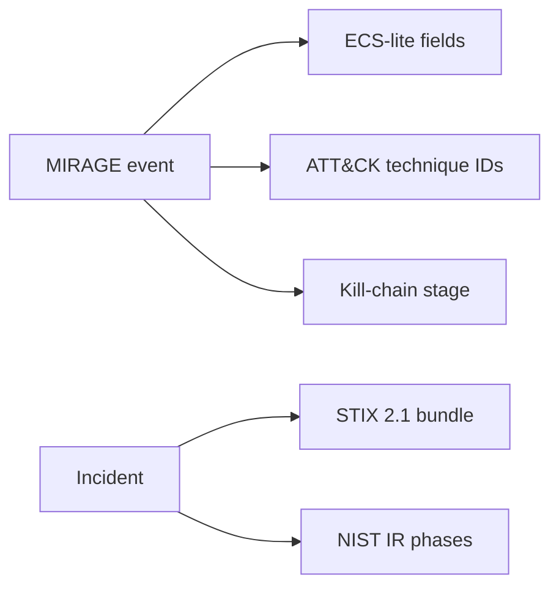
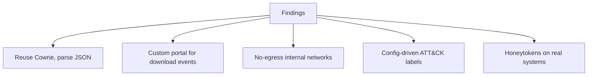
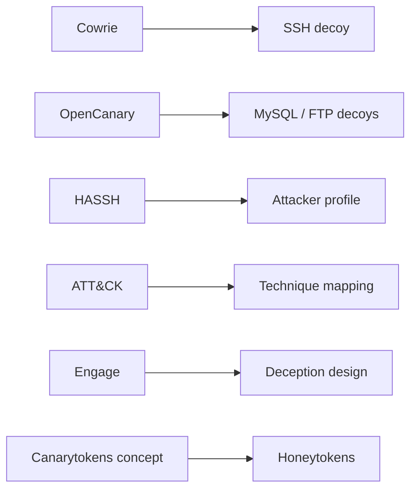
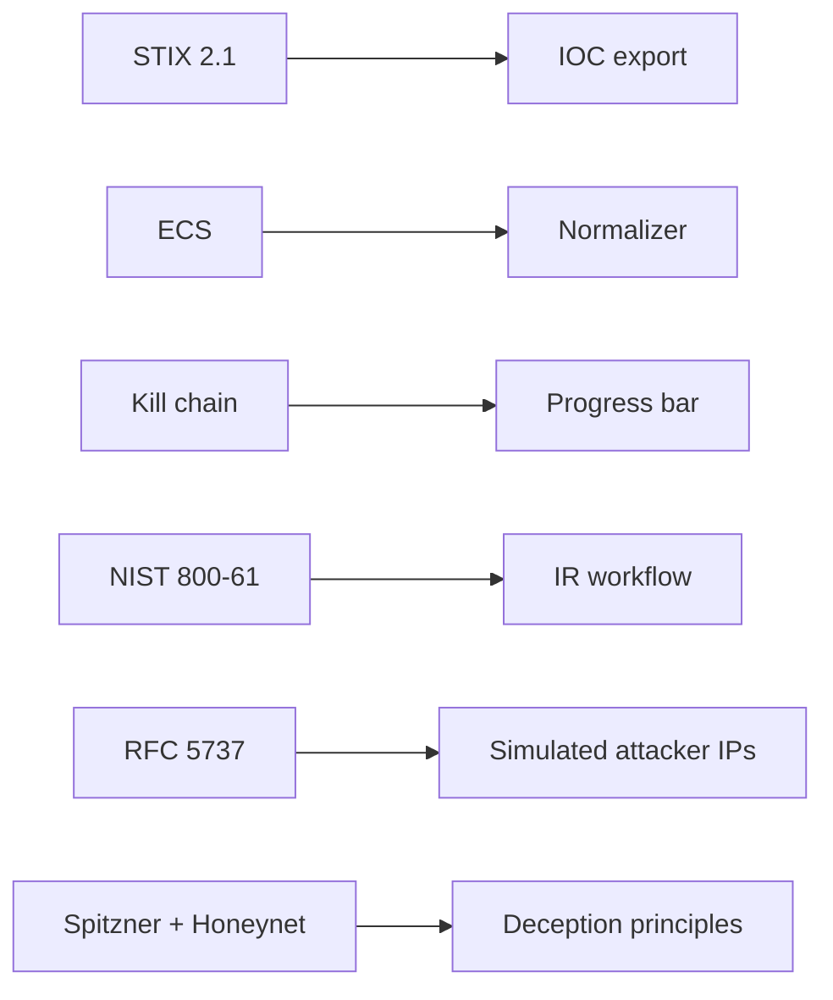

# SECTION 6 — Research & References (Slides 6.1 – 6.6)

> Verify every link once before submission (links and version numbers change). Items marked **[checked Oct 2026]** came from a web search during preparation.

---

## Slide 6.1 — Research Approach
**Title:** *What we studied, and how it shaped the design*

**On-slide content**
1. Honeypot engines and their log formats
2. Deception frameworks and best practice
3. MITRE ATT&CK structure and recent changes
4. SIEM schemas and intel sharing standards
5. Incident response lifecycle

**Diagram — research → design decisions**

**Speaker note:** "Each design decision traces back to a source."

---

## Slide 6.2 — Landscape: What Exists Today
**Title:** *Strong parts — no unified SOC workflow*

| Category | Examples | Strength | Gap |
|---|---|---|---|
| Honeypot platforms | T-Pot, Cowrie, OpenCanary | Realistic decoys, logs | No incident/attack-chain model, no response |
| Commercial deception | Thinkst Canary and others | Easy alerts | Limited open, explainable attack-story + response |
| SIEM | Elastic, Splunk | Search, retention | Treats honeypot hits as ordinary alerts |
| SOAR | Shuffle, Cortex XSOAR | Automation | Needs high-fidelity inputs |

**Diagram — qualitative positioning (our assessment, not a benchmark)**

**Speaker note:** "We're not replacing these tools — we connect decoy certainty to analyst workflow."

---

## Slide 6.3 — Standards We Align To
**Title:** *Built on open standards*

| Standard | How we use it |
|---|---|
| MITRE ATT&CK | Technique mapping + matrix view (v19 reorganized Defense Evasion into Stealth / Impair Defenses; v20 reported Oct 2026) **[checked Oct 2026]** |
| MITRE Engage | Deception planning vocabulary |
| Cyber Kill Chain (Lockheed Martin) | Progress bar stages |
| Elastic Common Schema (ECS) | Event field naming + NDJSON export |
| STIX 2.1 (OASIS) | IOC bundles |
| NIST SP 800-61 | Incident response workflow |
| RFC 5737 | Documentation-range IPs for simulated attackers |

**Diagram**

**Speaker note:** "Standards make our output usable by tools we've never met."

---

## Slide 6.4 — Key Findings From Research
**Title:** *Five findings that drove the architecture*

1. **Cowrie** logs structured JSON: logins, commands, file events, SSH client info (HASSH) → easy to normalize
2. Cowrie's own file events cover attacker downloads *into* the honeypot → we added a **custom portal** that logs explicit download-out events with honeytoken IDs
3. **Outbound fetches** by attackers are a safety risk → run decoys on **no-egress networks** (URL still logged as IOC)
4. **ATT&CK tactic labels change between releases**, technique IDs are stable → keep labels in config
5. **Honeytokens** deliver near-zero false positives and work anywhere, even on real hosts

**Diagram**

**Speaker note:** "Each finding became a line in the architecture."

---

## Slide 6.5 — References (Tools & Frameworks)
**Title:** *References — part 1*

| # | Reference | Link |
|---|---|---|
| 1 | Cowrie SSH/Telnet honeypot | https://github.com/cowrie/cowrie |
| 2 | OpenCanary (Thinkst) | https://github.com/thinkst/opencanary |
| 3 | T-Pot (Deutsche Telekom Security) | https://github.com/telekom-security/tpotce |
| 4 | Canarytokens (honeytoken service) | https://canarytokens.org |
| 5 | HASSH SSH client fingerprinting (Salesforce) | https://github.com/salesforce/hassh |
| 6 | The Honeynet Project | https://www.honeynet.org |
| 7 | MITRE ATT&CK | https://attack.mitre.org |
| 8 | ATT&CK release updates **[checked Oct 2026]** | https://attack.mitre.org/resources/updates/ |
| 9 | MITRE Engage (adversary engagement / deception) | https://engage.mitre.org |

**Diagram — how references map to components**

---

## Slide 6.6 — References (Standards & Literature)
**Title:** *References — part 2*

| # | Reference | Link / citation |
|---|---|---|
| 10 | STIX 2.1 specification (OASIS) | https://docs.oasis-open.org/cti/stix/v2.1/stix-v2.1.html |
| 11 | Elastic Common Schema | https://github.com/elastic/ecs |
| 12 | NIST SP 800-61 *Computer Security Incident Handling Guide* (check for the latest revision) | https://csrc.nist.gov/pubs/sp/800/61/r2/final |
| 13 | Lockheed Martin Cyber Kill Chain | https://www.lockheedmartin.com/en-us/capabilities/cyber/cyber-kill-chain.html |
| 14 | RFC 5737 — IPv4 documentation address blocks | https://datatracker.ietf.org/doc/html/rfc5737 |
| 15 | L. Spitzner, *Honeypots: Tracking Hackers* (Addison-Wesley, 2002) | book |
| 16 | Mandiant *M-Trends* annual report (attacker dwell-time data) | check the latest edition before quoting any figure |

**Diagram — citation map**

**Speaker note:** "If a judge asks 'where did that come from?', every box here has a source."
