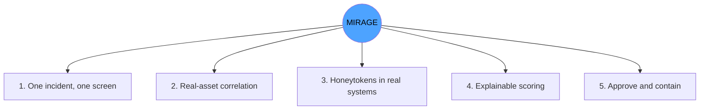
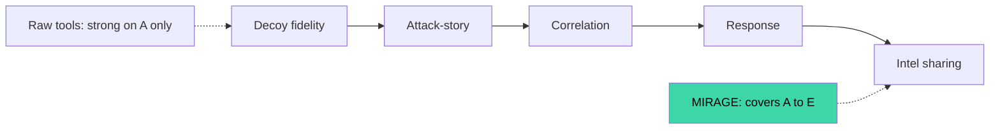
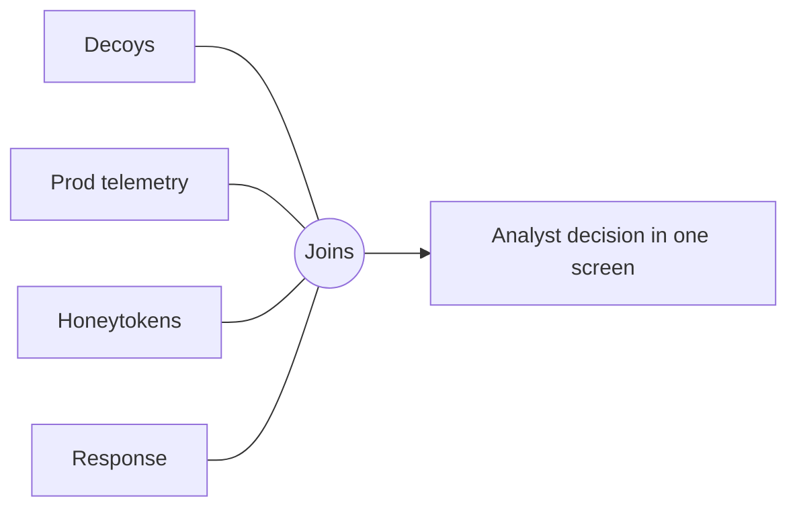
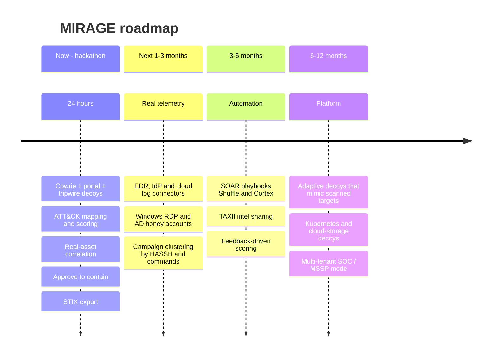
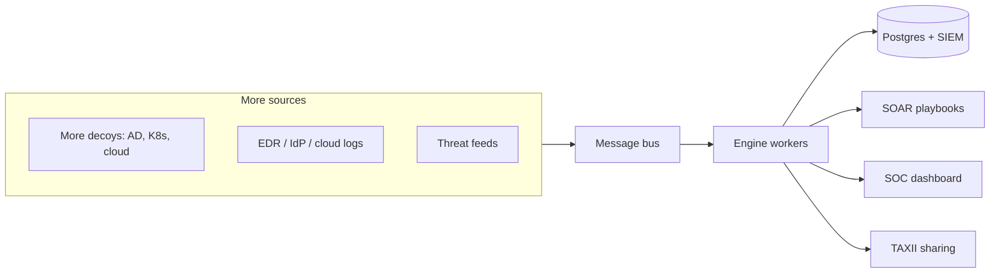
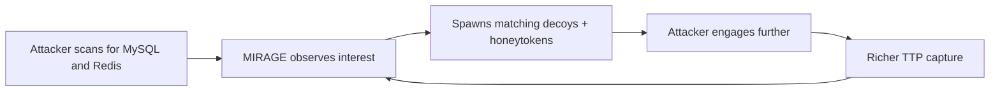

# SECTION 7 — USP & Future Scope (Slides 7.1 – 7.6)

---

## Slide 7.1 — Our Unique Selling Points
**Title:** *Five things only MIRAGE does together*

**On-slide content**
1. **One incident, one screen** — the whole attack chain, not a pile of alerts
2. **Real-asset correlation** — "did they touch anything real?" answered automatically
3. **Honeytokens in real systems** — confirmed lateral movement with near-zero false positives
4. **Explainable scoring** — every severity shows its factors; no black box
5. **Human-approved response with a visible effect** — approve, and the attacker is dropped

**Diagram — USP hub**

**Speaker note:** "Others offer a piece. We offer the connected loop from touch to containment."

---

## Slide 7.2 — Competitive Comparison
**Title:** *Where we fit*

| Capability | Raw honeypot + dashboard | Commercial canaries | SIEM only | **MIRAGE** |
|---|---|---|---|---|
| Real decoy services | ✔ | ✔ | ✘ | ✔ |
| Attack-chain incident model | ✘ | partial | ✘ | ✔ |
| ATT&CK + kill-chain mapping | partial | partial | rules-dependent | ✔ |
| Real-asset correlation | ✘ | limited | ✔ (manual) | ✔ (automatic) |
| Explainable score | ✘ | ✘ | varies | ✔ |
| Approved response + dry-run | ✘ | limited | ✘ | ✔ |
| STIX export | ✘ | varies | varies | ✔ |
| Open and offline | ✔ | ✘ | varies | ✔ |
*(Our assessment from public documentation — soften wording if challenged.)*

**Diagram — radar-style value stack**

**Speaker note:** "Fair comparison: they're strong at one link. We connect the chain."

---

## Slide 7.3 — Why It Is Hard to Copy Quickly
**Title:** *The moat is the integration*

**On-slide content**
- Value is in the **joins**: decoy ↔ production ↔ honeytoken ↔ response
- Open schema + rule files → community can extend quickly
- Honeytoken registry + correlation logic compound with every new decoy

**Diagram**

**Speaker note:** "Anyone can run a honeypot. Joining it to everything else is the product."

---

## Slide 7.4 — Future Scope: Product Roadmap
**Title:** *From hackathon prototype to SOC platform*

**Diagram — timeline**

**Speaker note:** "Each step reuses the same schema, rules, and dashboard."

---

## Slide 7.5 — Future Scope: Technical Extensions
**Title:** *What we'd build next*

| Area | Extension |
|---|---|
| Decoys | RDP/Windows, Active Directory honey accounts, Kubernetes API, S3-style canary buckets, IoT/OT |
| Intelligence | Known-scanner enrichment, graph clustering, Sigma rule generation from observed TTPs |
| Response | EDR isolation API, SOAR playbooks, ticketing integration |
| Analytics | Learning-to-rank from analyst feedback, anomaly detection on top of deception truth data |
| Scale | Kafka / Redis Streams, partitioned engine workers, Elastic/Splunk long-term store |
| Trust | Signed logs, RBAC, audit export, multi-tenant isolation |

**Diagram — future architecture**

**Speaker note:** "The prototype's boxes stay; we add more inputs and outputs."

---

## Slide 7.6 — Adaptive Deception (the big idea)
**Title:** *Decoys that change to match the attacker*

**On-slide content**
- Observe what the attacker scans and searches for
- Auto-spawn decoys that resemble those targets and plant matching honeytokens
- Result: the deeper they go, the more convincing and informative the trap

**Diagram**

**Speaker note:** "Deception that learns from the attacker — our long-term vision."
