# SECTION 8 — Other Slides to Add (Slides 8.1 – 8.12)

> These complete the deck: opening, demo, safety, team, closing, and backup slides. Suggested final deck order is at the end.

---

## Slide 8.1 — Title Slide
**Title:** **MIRAGE**
**Subtitle:** *Every touch is a tell.*
**Line:** Deception-driven threat detection & response — a SOC dashboard powered by a honeypot network
**Footer:** Team name · Hackathon name · PS 04 · date

**Diagram — hero visual**
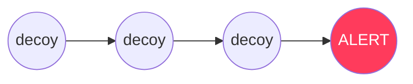
(Use a dark background with a faint network graph and one glowing red node.)

---

## Slide 8.2 — Hook / Opening Story
**Title:** *3:07 AM*
**On-slide content:** Thousands of alerts. One real attacker. It looks like all the others.

**Diagram**
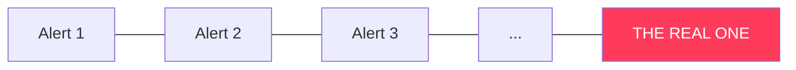
**Speaker note:** Pause two seconds after the line. Use illustrative framing, not a sourced statistic.

---

## Slide 8.3 — Live Demo Slide (transition)
**Title:** *Live demo*

**On-slide content (5 mini-steps):** Scan → Default creds → Commands → Data download → Bait credential on a real server → Approve

**Diagram — demo sequence**
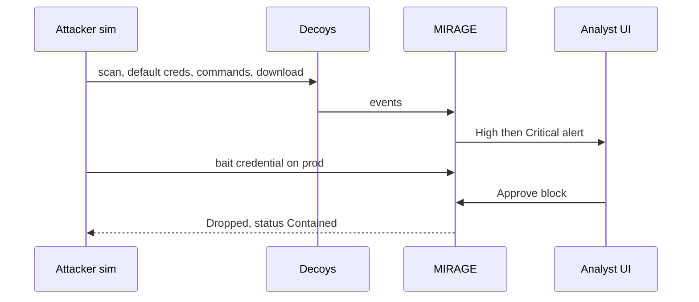
**Speaker note:** Switch to the dashboard. Follow the run-of-show in file 10 (§3).

---

## Slide 8.4 — Demo Screenshots (backup if live demo fails)
**Title:** *What you would have seen*

**On-slide content:** 4 screenshots in a 2×2 grid — Command Center · Incident (Critical, red real-asset panel) · Contained state · ATT&CK matrix

**Diagram — layout**
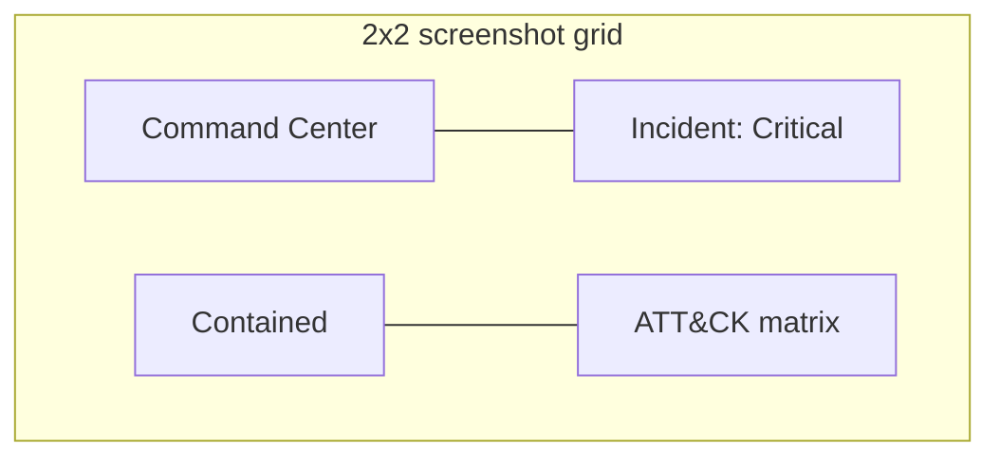

---

## Slide 8.5 — Safety & Ethics
**Title:** *Safe by design*

**On-slide content**
- Isolated internal networks, no egress, one-way logs
- Synthetic data, fictitious bait credentials
- Human approval + allowlist + audit trail
- Isolation test: all PASS *(paste screenshot)*

**Diagram**
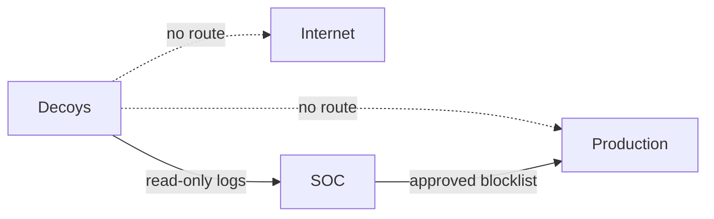

---

## Slide 8.6 — Architecture Overview (one-slide version)
**Title:** *How it works*

**Diagram — simplified for projection**
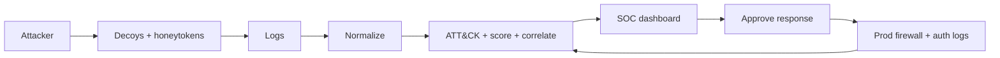
**Speaker note:** Use this simplified version when time is short; the detailed version is Slide 3.1.

---

## Slide 8.7 — Team
**Title:** *The team*

| Name | Role | Owned |
|---|---|---|
| [Name] | Deception / Infra | Honeypots, Compose, isolation, simulator |
| [Name] | Backend | Pipeline, API, WebSocket |
| [Name] | Security / Detection | Rules, scoring, correlation, STIX |
| [Name] | Frontend / Story | Dashboard, deck, video |

**Diagram**
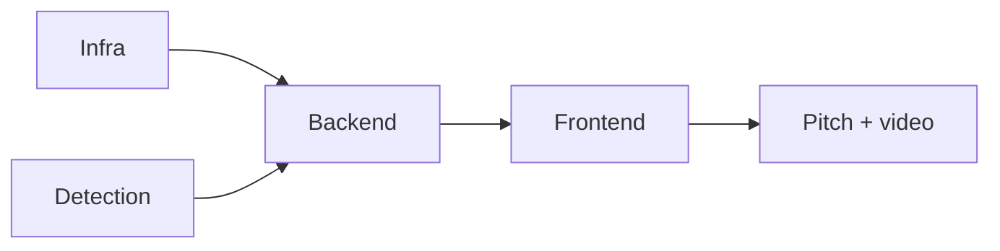

---

## Slide 8.8 — Business Model & Go-to-Market (optional)
**Title:** *Who pays, and how it grows*

**On-slide content**
- Open-core: free core, paid **managed decoys**, premium connectors, MSSP multi-tenant console
- Entry: SOC teams and MSSPs; regulated sectors (finance, healthcare, government)
- Land: pilot with 3 decoys + 5 honeytokens → expand

**Diagram**
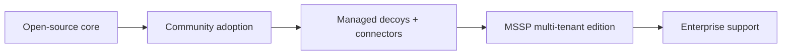
**Speaker note:** Keep this to 20 seconds; the problem is security, not a pricing pitch.

---

## Slide 8.9 — Challenges We Faced & How We Solved Them
**Title:** *Engineering honesty*

| Challenge | Solution |
|---|---|
| Decoys must never touch production | Internal networks, no shared segment, isolation test |
| Cowrie logs attacker downloads *into* the honeypot only | Custom portal logs explicit download-out events with honeytoken IDs |
| Simulated attackers all share Docker IPs | Alias map to RFC 5737 addresses + noise container source-IP aliases |
| ATT&CK labels changing | YAML-driven labels + version string |

**Diagram**
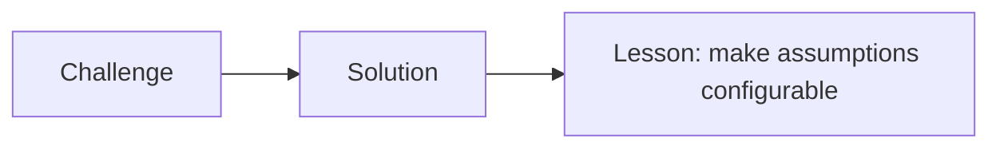

---

## Slide 8.10 — Limitations & Honest Assessment
**Title:** *What it doesn't do (yet)*

**On-slide content**
- Rule-based scoring; novel behaviors scored by stage + generic modifiers
- IP is a weak identity (NAT, proxies, Tor) → mitigated by honeytokens + fingerprints
- Production is simulated in the demo
- Skilled attackers can fingerprint honeypots → mitigated by realism + real-host honeytokens

**Diagram**
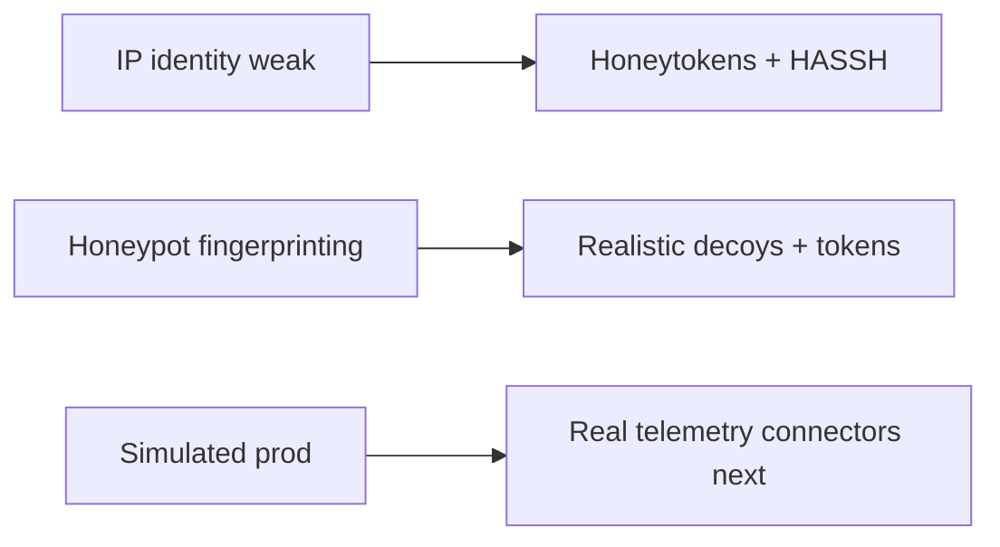
**Speaker note:** Judges respect honesty about limits more than silence.

---

## Slide 8.11 — Call to Action / The Ask
**Title:** *What we want next*

**On-slide content**
- Pilot MIRAGE alongside an existing SOC
- Partners for real EDR / identity / cloud telemetry
- Feedback on decoy designs and scoring rules
- Repo: [link] · Video: [link] · Contact: [email]

**Diagram**
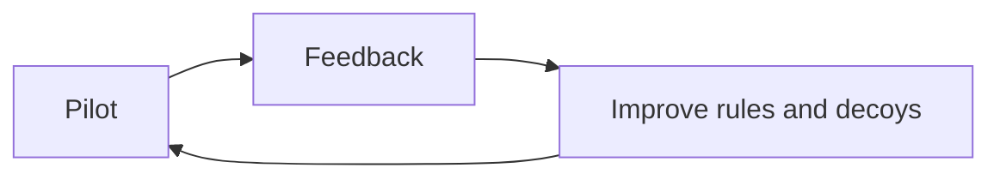

---

## Slide 8.12 — Closing Slide
**Title:** *Every touch is a tell.*
**On-slide content:** "Other tools tell you something touched a decoy. **MIRAGE tells you who, how far, whether it was real, and what to click.**"
**Footer:** Thank you · Questions?

**Diagram**
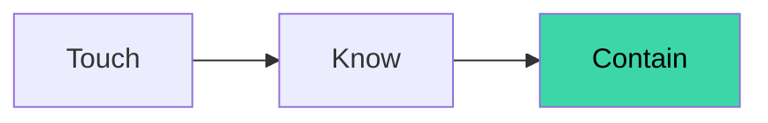

---

## Backup / Appendix slides
| # | Slide | Source |
|---|---|---|
| A1 | Scoring model table | File 07 §5 |
| A2 | ATT&CK mapping rules (excerpt) | File 06B §5.1 |
| A3 | Network matrix (what talks to what) | File 09 §3 |
| A4 | ER diagram | File 03 §6 |
| A5 | Q&A cheat sheet | File 15 §1 |
| A6 | Acceptance test table | File 10 §4 |

---

## Suggested final deck order (about 18 slides + appendix)
1. **8.1** Title
2. **8.2** Hook
3. **1.1** Alert flood
4. **1.3** Honeypot gap
5. **1.4** The attack in the PS
6. **2.1** Our idea
7. **2.2** Deception fabric
8. **3.1** Architecture
9. **3.4 / 3.5** Engine + scoring (merge into one if needed)
10. **2.5** Real-asset correlation (the differentiator)
11. **8.3** Live demo
12. **2.6** Response loop
13. **3.7 / 8.5** Safety
14. **4.1 / 4.2** Feasibility + 24 h plan
15. **5.1 / 5.2** Impact + measured KPIs
16. **7.1 / 7.2** USP + comparison
17. **7.4** Roadmap
18. **6.2 / 6.5** Research + references (compact)
19. **8.7** Team
20. **8.12** Closing

**Time-budget tip:** for a 5-minute slot, use slides 1, 2, 3, 5, 6, 8, 10, 11 (demo), 12, 13, 17, 20 and keep the rest as backup.
