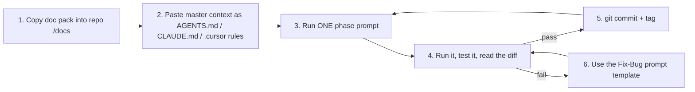

# 00 — How to Use These Prompts (Cursor / Claude Code / Windsurf / Copilot)

## 1. The workflow that works (follow it exactly)



### Step 1 — Put the documents where the AI can read them
```bash
mkdir mirage && cd mirage && git init
mkdir docs && cp -r <downloaded-pack>/* docs/      # the 00..15 files and slides/
```
The prompts say "read `docs/06B_...`". **This is the biggest quality boost**: the AI gets exact schemas, rules, and code skeletons instead of guessing.

### Step 2 — Install the master context (file `01_MASTER_CONTEXT_AGENTS.md`)
| Tool | Where to paste it |
|---|---|
| **Claude Code** | save as `CLAUDE.md` in repo root |
| **Cursor** | `.cursor/rules/mirage.mdc` (set "Always apply") or legacy `.cursorrules` |
| **Windsurf** | `.windsurf/rules/mirage.md` |
| **GitHub Copilot** | `.github/copilot-instructions.md` |
| **Codex / generic agents** | `AGENTS.md` in repo root |
(Same text everywhere.)

### Step 3 — Run prompts in order, one at a time
Order: `02` infra → `03` backend → `04` simulator + frontend → `05` integration/docs.
Never paste two phase prompts together. After each: run it, verify with the **acceptance check** listed in the prompt, commit.

## 2. Which AI mode for which job

| Job | Best mode | Why |
|---|---|---|
| Scaffolding (compose, Dockerfiles, project layout) | **Agent mode** (Cursor Agent / Claude Code) | Many files, needs to run commands |
| Engine logic (scoring, rules) | **Agent + tests-first** | Pure functions, easy to verify |
| UI pages | **Agent**, then small **inline edits** | Iterate visually |
| Debugging | **Chat with logs pasted** | Needs error context |
| Reviews / security audit | **Fresh chat**, no history | Avoids anchoring on earlier code |

## 3. Prompt-engineering rules used in this pack (copy the style for your own prompts)
Every prompt has the same skeleton:
```
ROLE        who the AI should act as
CONTEXT     what exists already + files to read
TASK        exactly what to build, numbered
CONSTRAINTS libraries, safety, style, what NOT to do
INTERFACES  exact schemas/endpoints/file paths (the contract)
ACCEPTANCE  commands the AI must run + expected output
OUTPUT      how to report back (files changed, how to run, known gaps)
```
Why it works:
1. **Contracts over vibes** — exact JSON shapes and file paths prevent integration drift between phases.
2. **Acceptance commands** — forces the agent to run and verify rather than "looks right".
3. **Negative constraints** — "do NOT add dependencies / do NOT touch X" prevents scope creep.
4. **Small blast radius** — one component per prompt, so a bad result is cheap to redo.
5. **Ask for gaps** — "list what you did NOT verify" makes the AI honest.

## 4. Universal tips
- Start every new chat with: *"Read CLAUDE.md (or AGENTS.md) and docs/05_DEVELOPMENT_ROADMAP_24H.md first."*
- If output is huge or wrong, **don't argue — revert** (`git checkout .`) and re-run with a tighter prompt.
- Pin versions: ask the AI to write exact versions into `requirements.txt` / `package.json`; avoid `latest`.
- Ask for **one failing test first** for engine code (tests-first prompts below).
- Review diffs for: hard-coded secrets, `0.0.0.0` exposed ports in the final compose, `privileged: true`, `localStorage`-style shortcuts, `dangerouslySetInnerHTML`, `allow_origins=["*"]` (acceptable only in lab; note it).
- Time-box: if a prompt isn't working after **2 retries**, use the fallback in the docs (e.g., custom SSH honeypot instead of Cowrie).
- Keep a `PROGRESS.md` the AI updates after each phase (prompt template in file 05).

## 5. Prompt index

| File | Contains |
|---|---|
| `01_MASTER_CONTEXT_AGENTS.md` | The always-on project brief (paste once) |
| `02_PHASE_PROMPTS_INFRA.md` | P1 scaffold · P2 Cowrie · P3 portal · P4 tripwire · P5 OpenCanary · P6 prod-sim · P7 isolation test |
| `03_PHASE_PROMPTS_BACKEND.md` | P8 schema/DB · P9 collector · P10 rules + classifier · P11 scoring/evaluator · P12 API + WS · P13 response + STIX · P14 tests |
| `04_PHASE_PROMPTS_SIMULATOR_FRONTEND.md` | P15 simulator · P16 frontend scaffold · P17 Command Center · P18 Incident page · P19 other pages · P20 polish |
| `05_PHASE_PROMPTS_INTEGRATION_DOCS.md` | P21 E2E · P22 reset/seed · P23 security review · P24 README/docs · P25 demo assets · fix-bug / refactor / explain templates |
